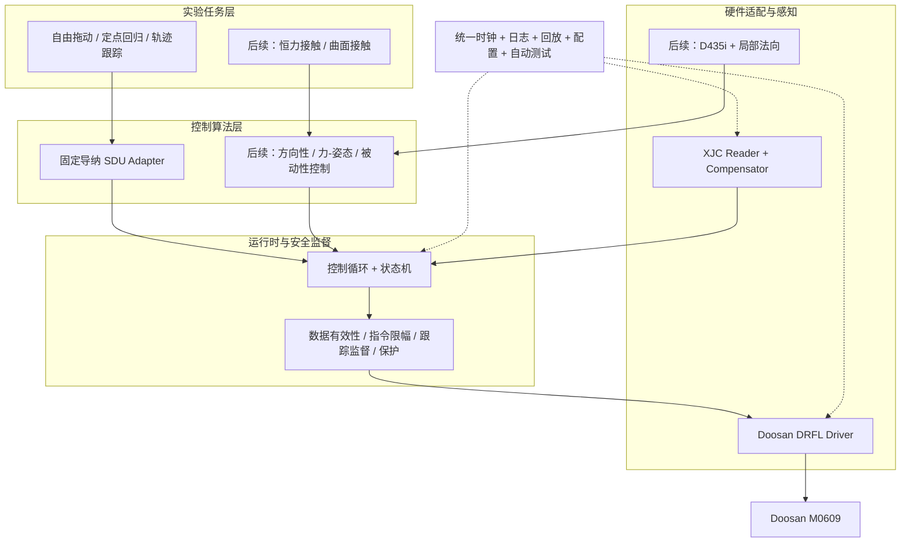
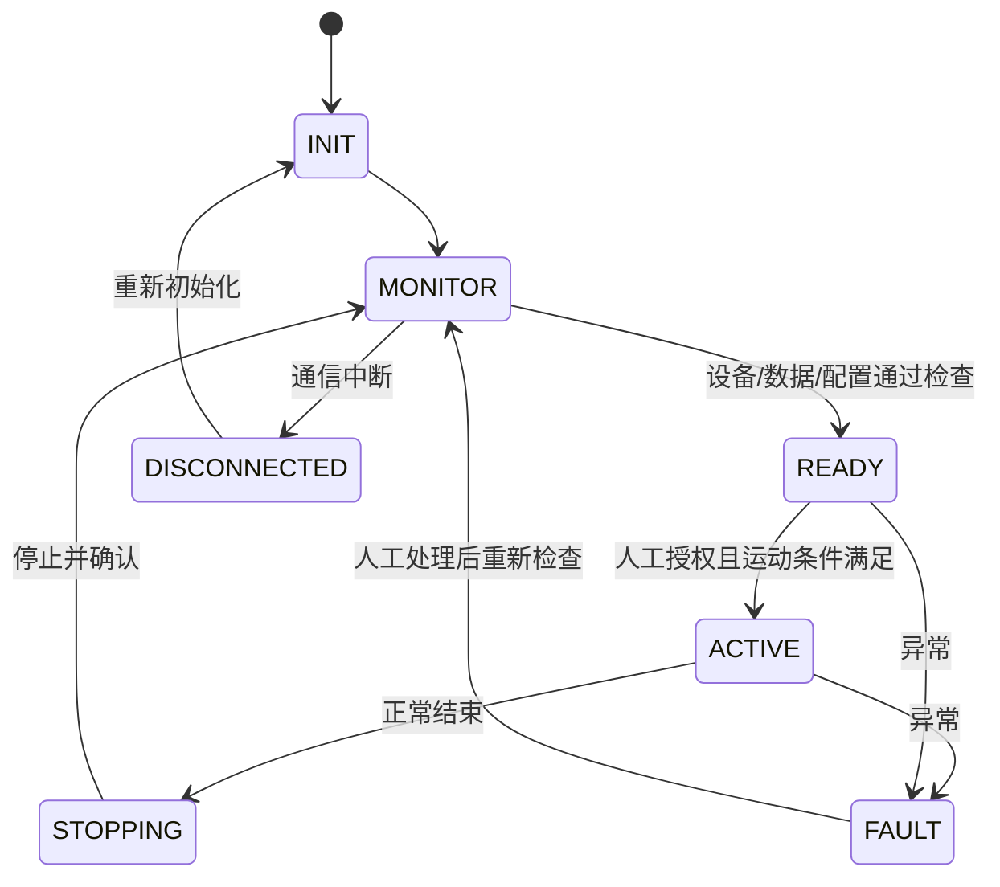

# Doosan M0609 视觉—力觉导纳控制研究：基础架构重构与后续实施方案

> **文档版本**：V1.0（2026-11-11）  
> **项目**：HZY_下一步探索  
> **研究平台**：Doosan M0609 + XJC 六维力/力矩传感器 + RealSense D435i（后续接入）  
> **软件环境**：Ubuntu / Linux、C++17、Doosan DRFL SDK、USB–RS485 / Modbus RTU  
> **文档性质**：待实施的工程与科研路线图，**不代表各阶段已经完成或通过验收**。  
> **依据**：用户提供的《当前系统实现说明.md》及此前讨论的开源导纳迁移和未知曲面接触理论方案。涉及当前系统的事实以该说明为准；涉及开源项目接口、兼容性、源码级工作量与理论首创性者均需进一步核实。

---

## 执行摘要

### 一句话目标

**在不推倒已有 Doosan M0609 硬件接口和标定成果的前提下，将现有四个初步运行的导纳程序重构为模块化、可测试、可回放的通用控制平台，再逐步增加恒力接触、局部视觉几何、力—姿态耦合和不确定性/被动性控制。**

### 总体原则

1. **旧工程冻结，不在原型上持续堆叠新功能**；现有实现作为功能基线和故障排查参考。
2. **“复用开源”与“复用硬件接口”分离**：导纳数学核心优先评价 SDU；Doosan DRFL 与 XJC 接口优先复用当前已调通的实现。
3. **一个功能一个权威实现**：正式运行时只允许一个运动命令发送者、一个激活的导纳积分器、一个可信的力觉处理链。
4. **先离线，后无接触，最后受限接触**：新控制器必须经过单测、模拟、日志回放和无接触实机验收。
5. **科研创新后置，理论工作可并行**：先冻结固定导纳基础平台，不以未验证的被动性模型作为早期实机控制依据。
6. **避免任务膨胀**：不强制迁移 ROS，不做完整三维重建、复杂路径规划或真实超声检测；不把 TCN/大规模学习列为必做项。

### 两个独立阶段

| 大阶段 | 目的 | 完成标志 |
|---|---|---|
| **阶段 I：基础平台重构** | 代码、数据、时序、安全、测试统一，恢复原有四种导纳功能 | `baseline-v1.0`：一套可运行、可复现、可回滚的控制系统 |
| **阶段 II：科学问题研究** | 恒力接触 → 曲面法向 → 力—姿态 → 几何不确定性/被动性 | 理论模型、充分条件/可辨识性分析、受限实机实验与对比结果 |

> **实施红线**：在 XJC 确切型号协议、轴序、符号和单位得到验证前，不应将当前候选解码作为已认证测力输入用于真实接触闭环。任何软件阈值和开源导纳都不能替代控制柜安全功能、现场风险评估及硬件急停。

---

# 第一部分　当前进度、问题和重构目标

## 1. 已完成内容（基于当前实现说明）

| 子系统 | 目前状态 | 具体说明 | 新系统处理方式 |
|---|---|---|---|
| Doosan M0609 | **已有原型** | DRFL TCP/IP，机器人反馈、控制权、`servol()` 连续笛卡尔目标 | 封装驱动；保留 SDK 调用逻辑，统一状态与生命周期 |
| Linux C++ | **已有原型** | C++17、Make、多可执行程序 | 新工程转 CMake + CTest；旧工程保持不动 |
| XJC 六维力采集 | **候选协议可读** | FTDI USB–RS485、Modbus RTU、六轴 float 候选映射 | 原始采集、协议解码、物理意义核验、超时检查分离 |
| 静态补偿 | **已有初步数据证据** | 20 姿态标定、力与力矩零偏/重力补偿 | 保留模型，编写回归测试；补充动态误差评估 |
| X 自由拖动 | **初步运行** | X 平移自由导纳，末端姿态固定 | 单一控制器 + X 轴使能配置 |
| XYZ 自由拖动 | **初步运行** | 三轴平移自由导纳，姿态固定 | 单一控制器 + XYZ 使能配置 |
| XYZ 定点回归 | **初步运行** | 非零刚度，受力偏离后回到参考点 | 同一控制器 + 非零刚度及固定参考配置 |
| Y 轨迹抗扰 | **初步运行** | Y 往返参考轨迹 + XYZ 运动修正 | 独立轨迹生成器 + 同一导纳控制器 |
| 姿态导纳 | **未实现** | 当前姿态保持固定，未利用力矩驱动姿态 | 研究阶段开发、先无接触姿态跟踪 |
| D435i 局部几何 | **未纳入当前 Doosan 工程** | 后续需要相机标定、ROI、法向估计 | 基础平台稳定后加入低频异步模块 |
| 被动性理论 | **研究设想** | 尚未证明具体离散/延迟条件 | 先离线建模和验证，不提前声称安全保证 |

### 1.1 现有硬件与软件事实

- 机械臂：**Doosan M0609**；当前 DRFL TCP/IP 控制与反馈，控制器现场地址以当前实际配置为准。
- 操作系统：Linux / Ubuntu；C++17。
- 力传感器：本地图纸名为 `XJC-6F-XD80-H28-200N-5N.m-F (RS485)`；系列资料称 `XJC-6F-D80`。**准确型号必须以铭牌和采购配置为准**。
- 图纸记载的三轴力额定量程为各 200 N、三轴力矩各 5 N·m；**额定量程不等于实验允许接触阈值**。
- 现有候选通讯解释：115200、8N1、站号 1、功能码 04、读取 12 寄存器，按大端 float32 解码为六维值。**这些细节尚未经准确型号厂家通讯手册逐项核实**。
- 当前导纳名义控制周期为 **20 ms（50 Hz）**，不能当作硬实时周期。
- 当前静态标定模型等效负载质量约 **0.54652165 kg**；质心估计约 **[10.0, 5.6, 54.4] mm**（相对传感器原点）。留出静态验证姿态力 RMSE 约 0.11–0.15 N、力矩 RMSE 约 0.003–0.010 N·m。**这些不代表动态接触精度**。

### 1.2 需要优先解决的工程缺陷

| 问题 | 当前迹象 | 重构目标 |
|---|---|---|
| 传感器定义未闭环核验 | 通讯映射、轴序与符号依据候选解释 | 协议证据 + 六轴独立方向测试 + 元数据版本 |
| 多个完整程序重复控制逻辑 | X / XYZ / 定点 / Y 轨迹分别编写 | 一套导纳引擎 + 不同任务/参数配置 |
| 数据单位不统一风险 | DRFL 位姿 mm/deg，导纳理论多为 m/rad | 内部 SI 单位；仅在驱动边界转换 |
| 坐标和力矩参考点容易混淆 | 当前只用平移力，姿态尚固定 | `frame_id` + `reference_point` + 明确变换测试 |
| 时间同步与延迟 | RS485 轮询、监控回调非同一时钟 | 单调时钟、样本年龄、实际周期、对齐策略 |
| 实时性不足 | 普通 Linux + TCP `servol()` | 实测抖动与延迟；不做硬实时保证 |
| 跟踪误差保护不一致 | X 模式有门限；部分 XYZ 模式只打印 | 统一控制命令验收与持续跟踪监测 |
| 软件工作空间边界缺失 | 旧程序部分 TCP 范围限制取消 | 针对实验工装的保守边界 + 控制柜安全配置 |
| 滤波/导纳更新关联不清晰 | 0.08 s 低通与 20 ms 外环 | 频响、时序、延迟与控制效果联合测量 |
| 旧日志可能不够完整 | 多程序不同字段 | 统一版本、状态、命令、传感器、事件记录 |

### 1.3 不重做的事情

- **不重写 DRFL 的基本网络连接与控制权协议**，只做隔离封装和状态正确性测试。
- **不无故重新采集所有 20 姿态标定数据**；若传感器映射/安装关系/原点发生变化，再重新采集与验证。
- **不把 ROS 2 / UDP 迁移列为基础重构前置条件**。
- **不在基础重构期间引入 RealSense、力矩姿态控制或在线学习**。
- **不把旧代码行为当作绝对真值**：必须增加独立数值解/物理模型对照。

---

# 第二部分　软件架构、开源选型和关键设计

## 2. 总体架构



> 控制器计算**候选运动目标**，不能越过安全监督直接调用 `servol()`；驱动层是唯一可以发送机器人运动命令的组件。

## 3. 开源组件选型和使用边界

### 3.1 首选导纳数学基础：SDU Robotics `sdu_controllers`

- 仓库：<https://github.com/SDU-Robotics/sdu_controllers>
- 选择理由：C++、可以与机器人硬件接口分离，公开导纳示例/测试，已包含位置和姿态导纳思想。
- 使用策略：**先独立复现、固定 commit，再以 Adapter 接入**；尽量不直接修改第三方源码。
- 需要重点核验：具体版本的构建参数、依赖与许可证，输入/输出变量定义、四元数顺序、固定频率假设、积分及重置机制。
- 重要限制：其位置/姿态导纳能力不等于已经具备本研究所需的**任意耦合 6×6 导纳、可变 `dt` 或严格被动性**。

### 3.2 六维控制参考：`force_control`

- 仓库：<https://github.com/yifan-hou/force_control>
- 用途：借鉴六维 wrench/twist 表达、笛卡尔柔顺方向、力/速度混合控制及参数设计。
- **不是第二个同时参与机器人控制的导纳引擎**；如果后续对照，需实现为互斥的独立控制器。

### 3.3 机器人接口来源：Doosan `API-DRFL`

- 仓库：<https://github.com/DoosanRobotics/API-DRFL>
- 当前沿用 TCP `servol()`；Doosan SDK 及机器人固件版本与样例须对应核验。
- UDP 实时接口仅作为**有量化证据的后续备选**，不能与基础架构重构同步迁移。

### 3.4 开源使用记录

在 `docs/dependencies.md` 中记录每个依赖的仓库地址、commit、许可证、构建命令、当地修改、版本兼容情况。**不复制第三方仓库的全部源码后自行改名；保留版权和许可要求。**

## 4. 推荐代码布局（目标形态，分阶段创建）

```text
doosan_vf_admittance/
├── CMakeLists.txt
├── README.md
├── LICENSES/                  # 第三方许可文本/说明
├── cmake/                     # Doosan SDK 等查找配置
├── config/
│   ├── robot.yaml
│   ├── sensor.yaml
│   ├── admittance.yaml
│   ├── safety.yaml
│   └── experiments/
│       ├── free_drag_x.yaml
│       ├── free_drag_xyz.yaml
│       ├── point_return.yaml
│       └── trajectory_y.yaml
├── third_party/
│   └── sdu_controllers/       # 固定 commit；可用 submodule
├── include/vf_control/
│   ├── core/
│   │   ├── types.hpp
│   │   ├── units.hpp
│   │   ├── frames.hpp
│   │   └── time.hpp
│   ├── hardware/
│   │   ├── robot_interface.hpp
│   │   ├── doosan_driver.hpp
│   │   ├── force_sensor_interface.hpp
│   │   └── xjc_driver.hpp
│   ├── estimation/
│   │   ├── ft_compensator.hpp
│   │   ├── wrench_transform.hpp
│   │   └── time_alignment.hpp
│   ├── controllers/
│   │   ├── admittance_interface.hpp
│   │   └── sdu_adapter.hpp
│   ├── runtime/
│   │   ├── control_loop.hpp
│   │   ├── supervisor.hpp
│   │   └── state_machine.hpp
│   └── tasks/
│       ├── free_drag.hpp
│       ├── point_return.hpp
│       └── trajectory_following.hpp
├── src/
│   ├── hardware/
│   ├── estimation/
│   ├── controllers/
│   ├── runtime/
│   └── tasks/
├── apps/
│   ├── sensor_monitor.cpp
│   ├── robot_monitor.cpp
│   ├── robot_servo_test.cpp
│   ├── offline_replay.cpp
│   └── run_experiment.cpp
├── tests/
│   ├── unit/
│   ├── integration/
│   ├── regression/
│   └── fault_injection/
├── tools/
│   ├── plot_logs.py
│   └── evaluate_results.py
├── docs/
│   ├── architecture.md
│   ├── data_contract.md
│   ├── coordinate_frames.md
│   ├── safety_protocol.md
│   ├── dependencies.md
│   └── migration_report.md
├── data/                       # 原始数据按需保存，避免提交大体积文件
├── logs/
├── results/
└── experiments/                # 后续接触/曲面实验协议
```

> 所有未来文件均按 Gate 增量加入，**不要第一天就空建整个目录**。

## 5. 最关键的四个软件接口

### 5.1 `RobotState` 与 Doosan 适配层

内部统一使用 SI 单位；Doosan 原生单位（位置 mm、姿态 deg、关节 deg）只能在驱动边界存在。建议的概念字段：

```cpp
struct RobotState {
    Eigen::Matrix<double, 6, 1> q_rad;
    Eigen::Isometry3d T_base_tcp;
    Eigen::Matrix<double, 6, 1> twist_base_tcp;
    MonotonicTime sample_time;
    bool connected;
    bool motion_allowed;
    bool valid;
};
```

- `twist` 中角速度使用 rad/s；若 SDK 监控没有提供可靠的实际速度，需要估计或单独标记不可用。
- 姿态转换必须使用经 SDK 版本确认的约定，**不能按字段名称猜测 RPY/ZYZ**。
- 驱动发送目标前执行 SI→SDK 转换、约束检查和命令序号记录。
- `servol()` 的调用成功只代表命令被接受；**不能代表末端已经到达**。

### 5.2 `WrenchSample`、补偿与作用点

建议的数据契约：

```cpp
struct WrenchSample {
    Eigen::Vector3d force_N;
    Eigen::Vector3d torque_Nm;
    MonotonicTime sample_time;
    FrameId frame_id;
    PointId reference_point;
    bool compensated;
    bool valid;
};
```

需要保留 **原始读取 → 经协议校验的六轴值 → 静态补偿 → 坐标变换 → 接触点变换** 全链路数据。传感器坐标系与参考点都必须显式定义。

对同一坐标系下的力矩参考点变换：

\[
\boldsymbol\tau_P=\boldsymbol\tau_O-\mathbf r_{OP}\times\mathbf f,
\]

其中 \(\mathbf r_{OP}\) 是从旧参考点 \(O\) 指向新参考点 \(P\) 的向量；再根据需要进行坐标旋转。程序必须有解析单测。

当前 `q_flange_sensor=0,0,0,1` 表示**传感器轴与法兰轴对齐的模型假设**，拆装或重新标定后不能直接沿用。

### 5.3 `IAdmittanceController`：控制器与设备彻底解耦

```cpp
class IAdmittanceController {
public:
    virtual ~IAdmittanceController() = default;
    virtual void reset(const ControlContext& ctx) = 0;
    virtual ControlOutput update(const ControlInput& in) = 0;
};
```

`ControlInput` 至少包含：实际状态、补偿 wrench、参考位姿/速度、有效性与时间信息、所需柔顺轴；后续可扩展目标 wrench、局部几何、控制模式。`ControlOutput` 返回候选位姿/速度、有效标志与诊断量，**绝不包含 SDK 调用**。

### 5.4 `IExperimentTask`：四种模式只改变任务配置

| 任务 | 参考运动 | 弹簧刚度 | 使能轴 | 迁移目标 |
|---|---|---|---|---|
| Free-X | 当前起始位置或保持位置 | `K=0` | X | 松手后留在新位置 |
| Free-XYZ | 当前起始位置或保持位置 | `K=0` | XYZ | XYZ 拖动 |
| Point-Return | 固定起始参考位姿 | `K>0` | XYZ | 偏离后恢复 |
| Y-Trajectory | 移动的 Y 轨迹 | `K>0` | XYZ | 受扰后回当前参考轨迹 |

旧实现当前常见参数是 \(M=1\,\mathrm{kg},D=12\,\mathrm{N\,s/m}\)，非零弹簧 \(K=36\,\mathrm{N/m}\)，死区 0.25 N、低通时间常数 0.08 s、目标速度限制约 30 mm/s。**迁移时这些仅作回放对照初值，不是统一安全参数，也不意味着 SDU 内核在相同数值下必然有相同响应。**

---

# 第三部分　基础平台重构 Gate 0–Gate 6

## 6. Gate 通用准入/验收规则

每个 Gate 采用：

1. **输入**：上一步已冻结的代码/配置/数据；
2. **任务**：尽量小范围修改；
3. **独立测试**：无需实机即可判断的测试必须先通过；
4. **联调**：设备只按批准的模式启用；
5. **验收**：数据、图、日志和问题列表齐全；
6. **回退**：失败时恢复最近冻结版本，不跨越未解决缺陷。

| Gate | 目标周期（估算） | 核心成果 | 必须满足的准入条件 |
|---|---|---|---|
| G0 | 第 1 周 | 冻结旧工程和四组回放数据 | 无 |
| G1 | 第 1–2 周 | SDU 独立复现/选型结论 | G0 数据可用（可并行准备） |
| G2 | 第 2–3 周 | 新框架与 Doosan/XJC 只读适配 | G0；SDK/协议核查进行中 |
| G3 | 第 3–4 周 | 导纳适配器与离线回放 | G1 选型、G2 数据接口 |
| G4 | 第 4–6 周 | 四种经典导纳迁移 | G3 单测、G2 运动接口验收 |
| G5 | 第 6–7 周 | 运行时、安全、回归体系完善 | G4 各功能稳定 |
| G6 | 第 7–8 周 | `baseline-v1.0` 冻结 | G0–G5 证据齐全 |

> 时间是工作量规划，不作为承诺；对真实机器人使用应以安全审批、现场环境和验收结果为准。

## 7. G0：原型冻结与基线数据保存

**目的**：不让代码重构破坏已有成果；建立之后比较的共同数据口径。

### 具体任务

- [ ] 备份现有 `doosan_ft_calibration_cpp` 的全部源码、Makefile、README、标定模型、元数据及已有日志。
- [ ] 为原工程建立只读 `legacy-baseline` Git tag 或归档；新工作从另一仓库/分支进行。
- [ ] 导出四种模式的控制参数、状态条件、坐标系和停止行为，写成 `docs/legacy_modes.md`。
- [ ] 整理四种实验的历史原始日志；对缺失的字段允许用**独立监视程序补录**，不得为了补录而改变旧控制算法。
- [ ] 为标定模型、原始数据、机器人 SDK 和配置创建 `manifest.json`（包括文件哈希、记录日期、程序版本）。
- [ ] 确认旧工程仍可单独编译运行；只有在经过授权且安全时才进行实机复验。

### 必备日志字段

`timestamp`、机器人实际 TCP/法兰位姿、关节状态、XJC 原始 wrench、补偿 wrench、导纳参考/目标/实际位置、模式、`dt`、控制权与保护状态、错误码、版本号。

### 四类基线数据

| 数据集 | 内容 | 最低证明 |
|---|---|---|
| `free_x` | X 单轴受力/释放 | 可观察速度/位置响应 |
| `free_xyz` | XYZ 受力/释放 | 三轴方向与耦合情况 |
| `point_return` | 受力偏移后松手 | 参考位置恢复过程 |
| `trajectory_y` | 名义 Y 往返与抗扰 | 参考/命令/实际轨迹可分离 |

**验收**：旧代码独立可构建，原始数据未被覆盖，可用统一脚本绘制四种结果；`G0_report.md` 保存历史限制。  
**失败回退**：无法获得完整历史日志时，标记数据缺口并用仿真合成回放补足单测，不伪造“真实实验数据”。

## 8. G1：SDU 开源导纳复现与是否采用的决策

**目的**：先证实新依赖适合，再决定迁移；不要先锁死架构。

### 具体任务

- [ ] 克隆 SDU 仓库，固定 commit；逐条确认许可证、构建前提、公开测试与示例。
- [ ] 用独立构建环境编译库、运行自身测试及示例，记录环境和日志。
- [ ] 建立一维解析/数值对照：零输入、恒定力、阶跃、短时脉冲、非零刚度回零。
- [ ] 检查位置、速度、姿态状态变量定义，尤其是**位置与位置偏移是否混用**。
- [ ] 检查 `reset` 是否清除积分状态；参数更新是否连续；四元数规范和归一化。
- [ ] 测试名义 50 Hz，同时用回放模拟 20 ms 周围的采样抖动和偶发延迟。
- [ ] 明确该版本是否支持可变 `dt`；若不支持，不在实机上把实际非等间隔周期当成完全等间隔。

### 初始构建命令（须以实际仓库 README/CMake 选项核验）

```bash
# 离线复现，仅示意，先核验当前仓库支持的选项
git clone https://github.com/SDU-Robotics/sdu_controllers.git
cd sdu_controllers
git rev-parse HEAD
git submodule update --init --recursive
cmake -S . -B build -DCMAKE_BUILD_TYPE=Release
cmake --build build -j
ctest --test-dir build --output-on-failure
```

### 必须做出的 ADR（架构决策记录）

**方案 S：直接采用 SDU 内核**：其计算状态、周期假设、复位和输出可与项目可靠匹配。  
**方案 L：轻量自研内核**：若修改 SDU 积分器/状态约定的成本过高，保留 SDU 的测试与数学对照，重新实现清晰的 `dt` 驱动内核。必须确保自研内核也通过同一套测试。

> 不论采用哪一条，正式系统只保留一个**当前生效**的固定导纳内核；另外的实现只作为独立基线或回放对照。

**验收**：`G1_sdu_evaluation.md`、固定 commit、构建环境、控制器响应图、选型理由。  
**失败回退**：保留 SDU 外部独立测试，不把不兼容实现硬塞进 Doosan 控制循环。

## 9. G2：统一工程骨架、硬件和数据契约

**目的**：新系统能只读监测设备、无接触低速控制机器人并记录数据，但暂不接入导纳闭环。

### 具体任务

- [ ] 创建独立 CMake 工程及 `vf_core`、`vf_hardware`、`vf_estimation`、`vf_runtime`、`vf_tests` 等 target。
- [ ] 完成 `RobotState`、`WrenchSample`、`PoseReference`、`ControlInput/Output` 的接口文档。
- [ ] 单独封装 XJC 串口：接收与 CRC、字节解码、通道映射、错误/超时、原始数据时间戳。
- [ ] **厂家协议核查**：确认准确型号、寄存器地址、字节顺序、单位、符号；逐轴静态测试并形成记录。
- [ ] 单独封装静态补偿：对历史 20 姿态数据进行新旧回归对照；法兰、传感器、TCP 的姿态与力矩作用点必须明确。
- [ ] 单独封装 Doosan：控制权与状态管理、只读监视、`servol()` 低速目标与经过验证的停止流程。
- [ ] 添加独立 `MockRobot` 和 `RecordedFTSensor`，在无硬件条件下运行系统。
- [ ] 接入时间戳、样本年龄和非阻塞日志；并明确 TCP 和 RS485 不共享硬件同步时钟。

### 先形成三个小程序

| 程序 | 模式 | 验收重点 |
|---|---|---|
| `sensor_monitor` | 只读 | 六轴定义核实、补偿、漂移、异常数据 |
| `robot_monitor` | 只读 | 控制状态、反馈单位与姿态正确 |
| `robot_servo_test` | **无接触低速** | 运动命令格式、跟踪、停止和异常响应 |

### 时序与日志

- 三个时间点要分开：设备/SDK 采样时刻（如果可得）、主机接收时刻、控制器使用时刻。
- 数据年龄至少分别记录 `age_ft`、`age_robot` 和实际 `dt`；过期数据进入无效状态。
- 不应让力传感器采集线程直接调用机器人运动接口；日志写盘不得阻塞控制线程。

**验收**：新工程不依赖旧程序即可读取机器人和力数据；补偿数据回放与旧模型一致；无接触低速运动和停止已验证。  
**失败回退**：遇到通信/控制权问题仅回到只读监视；不通过自动复位报警或提高异常阈值继续运行。

## 10. G3：开源导纳适配、MockRobot 和离线回放

**目的**：软件闭环先在离线条件下完成，确保控制核心不直接操作机器人。

### 具体任务

- [ ] 实现 `IAdmittanceController` 与 `SDUAdmittanceAdapter`（或 G1 决定的自研内核）。
- [ ] 实现力方向/坐标转换、参考轨迹、目标位姿、四元数和 SI 单位转换。
- [ ] 明确每种模式下的动力学：`K=0` 自由、`K>0` 回零、移动参考轨迹的力响应。
- [ ] 给控制器添加启动/结束/异常 `reset`，避免上次积分状态污染下次实验。
- [ ] 引入合成力输入与 G0 历史力数据，分别计算**旧原型、候选内核、独立参考模型**的结果。
- [ ] 比较实际 `dt` 抖动、滤波时间常数、死区和限幅位置对结果的影响。
- [ ] 任何输出必须先由 `CommandValidator` 检查；此时仅输出到 `MockRobot`。

### 回放一致性的正确理解

- **数学等价测试**：同样模型、同样离散法、同样输入应实现规定精度的一致性。
- **功能等价测试**：若 SDU 与旧实现离散化不同，不要求逐样本完全相同；但应满足可解释的动力学响应和业务功能。
- **旧程序不是物理真值**：不允许为了匹配原程序而保留显然错误的坐标/单位处理。

**验收**：`offline_replay` 可运行四类模拟输入并输出完整日志；控制数学单测通过；提供差异原因说明。  
**失败回退**：先核对符号、积分器、采样、滤波与参考定义；不通过人为调整大量参数“凑到曲线相似”。

## 11. G4：原有四种导纳功能逐个迁移

**目的**：使用一个统一控制器和四套任务配置替代四份完整程序。

### 迁移顺序（必须依次进行）

1. **X 单轴自由导纳**：仅 X 轴使能、`K=0`；验证方向、释放后保持和命令连续性。
2. **XYZ 自由导纳**：扩展轴使能；验证不同轴作用力不产生错误方向响应。
3. **XYZ 定点回归**：设固定参考位置及正刚度；验证释放后恢复，明确积分状态与偏移定义。
4. **Y 轨迹抗扰**：独立轨迹生成器产生参考位置，导纳输出偏移，统一监督下组合命令。

### 单个模式的准入流程


### 新旧对照内容

| 维度 | 核查内容 |
|---|---|
| 动力学 | 输入方向、运动方向、阻尼衰减、刚度回归 |
| 数值 | 位置/速度连续、无 NaN、无异常积分漂移 |
| 跟踪 | 实际末端与命令目标误差、控制周期抖动 |
| 状态 | 控制权、启停、异常、重新初始化 |
| 物理行为 | 单轴拖动、三轴拖动、回归、参考轨迹抗扰 |
| 回滚 | 一键切回旧基线，避免两个程序同时发送命令 |

### 需要纠正而非照搬的旧行为

- X 模式原有较高默认软件合力阈值**不能**直接用于接触实验；阈值须按工装和风险分析重新确定。
- XYZ 等模式先前只打印跟踪误差，后续须统一监测与处理，但阈值要由正常跟随误差和停止性能确定。
- 原程序部分没有 TCP 绝对软件区域限制；新研究系统需要适合当前工装的附加区域约束。
- `servol()` 的跟随加速度参数与虚拟导纳目标加速度**分属不同层次**；对过去出现过的 SDK 1215 报警保留回归检查。

**验收**：四种模式均在同一个 `run_experiment` 入口下以不同配置运行；彼此无重复硬件逻辑；行为可回放且差异有记录。  
**失败回退**：退回上一冻结模式，不在实机上通过无限增加速度/力阈值排查错误。

## 12. G5：可靠运行时、监督机制和自动化测试

**目的**：研究平台可长期迭代，不依赖人工记忆每种模式的特殊处理。

### 统一运行时状态机



### 运行时必须检查

- 机器人运行/安全状态、控制权及监控回调有效性；不得自动复位急停和保护停机。
- XJC 数据年龄、有效性、帧错误、异常跳变和量程状态。
- 期望位姿合法、连续、单位正确、姿态四元数正确。
- TCP 工作区、关节范围、速度/加速度、参考轨迹可执行性。
- 指令与实际位置/姿态跟踪误差，允许的连续超限次数。
- 过期、周期偏离、SDK 报警、进程退出时的已验证停止策略。
- 控制输出的 NaN/Inf、数值发散、积分饱和。
- 单个运动命令发送者的互斥性。

### 自动测试矩阵

| 类别 | 例子 | 运行时机 |
|---|---|---|
| 数学单测 | 一维阶跃、阻尼/刚度、正定性、积分重置 | 每次改动算法 |
| 坐标测试 | 旋转、力矩力臂、四元数往返、单位变换 | 每次改动数据接口 |
| 串口测试 | 错帧、CRC 错、超时、异常长度、重复数据 | 每次改动 XJC 驱动 |
| 回归测试 | 四类历史数据回放、配置快照 | 每次合并代码 |
| 集成测试 | MockRobot + RecordedFT + 控制循环 | 每次改动运行时 |
| 故障注入 | 网络中断、数据过期、控制权丢失、NaN | 每次改动监督逻辑 |
| 实机无接触 | 速度限制、跟踪误差、正确停止 | Gate 完成时经批准 |

### 推荐质量工具

- CMake + CTest（基础测试）；
- Clang-Tidy、编译警告和格式检查；
- AddressSanitizer / UndefinedBehaviorSanitizer（**离线/测试构建**，不直接用于未经验证的实机实时控制）；
- Git tag、配置哈希、实验 manifest。

**验收**：常见软件故障有自动测试，真实运行状态与原始数据能完整追溯，异常不会继续向机器人发送不可信运动目标。  
**失败回退**：所有非安全关键的新功能可关闭；基础监测程序可独立运行。

## 13. G6：冻结基础研究平台 `baseline-v1.0`

**冻结前验收表：**

- [ ] Doosan 只读、授权、运动和停止流程均验证；
- [ ] XJC 的准确协议/轴序/符号/单位已核实，标定模型可追溯；
- [ ] 静态补偿回放与独立留出结果一致；
- [ ] 控制器离线单测与数值对照通过；
- [ ] X 自由、XYZ 自由、定点回归、Y 轨迹四种模式均有记录；
- [ ] 真实控制周期、数据年龄、跟踪误差已统计；
- [ ] 保护机制和停止过程通过相应测试；
- [ ] 一条命令发送链和统一配置入口；
- [ ] 工程依赖、SDK 版本、第三方许可证和 Git commit 有记录；
- [ ] 回放脚本与图表能够独立重现。

### 交付目录（参考）

```text
releases/baseline-v1.0/
├── release_notes.md
├── git_commit.txt
├── dependency_manifest.json
├── calibration_manifest.json
├── configs/
├── test_report.md
├── timing_report.md
├── regression_summary.csv
└── known_limitations.md
```

**冻结定义**：以后研究算法可以在新分支中迭代，但 `baseline-v1.0` 不因新增接触/视觉功能而修改基础行为。若发现基础缺陷，应按可追溯补丁流程发布修订版。

---

# 第四部分　基础平台之后的科研实现路线

> 这里的目标是在统一平台上增量开发，不再为每一个科研实验重新写硬件通信、数据处理和控制循环。

## 14. R1：法向恒力接触（建议 2 周，基础平台通过后）

### 科学/工程目标

从自由拖动导纳转向真实接触后的**目标法向力跟踪**，建立之后所有曲面实验的基线。

### 控制思路

在工具法向已知、力符号经过验证的情况下，设目标法向力 \(F_d\)，实测法向力 \(F_n\)：

\[
e_F=F_d-F_n.
\]

考虑受限的法向导纳位移修正 \(\delta_n\)：

\[
M_n\ddot\delta_n+D_n\dot\delta_n+K_n\delta_n=s_ne_F.
\]

其中符号 \(s_n\) 由接触坐标与实测方向确定。**若 \(K_n>0\)，稳态位置偏差可能平衡非零力误差**；是否需要积分补偿必须通过理论与数据验证，不能直接宣称零稳态误差。

### 开发任务

- [ ] 新增 `ForceTrackingController`，输入为明确作用点和方向的法向力；
- [ ] 增加 `APPROACH → CONTACT → FORCE_TRACK → RETREAT` 任务状态；
- [ ] 设置力传感器异常、接触丢失、持续超力、位置界、超时保护；
- [ ] 通过离线单侧弹簧/阻尼接触模型测试控制符号及稳定性；
- [ ] 经过现场风险评估后进行低速平面接触和恒力保持；
- [ ] 记录目标力、实测力、实际位姿、命令、峰值、超调、RMSE 和停止原因。

**成果**：`fixed_normal_force_baseline`；**回退**：仅保留监测与非接触测试，不能用提高软件停机阈值替代排查。

## 15. R2：平面恒力轨迹跟踪（建议 1 周）

复用已迁移的 Y 轨迹参考生成器，把平移运动分为切向任务运动与法向导纳修正：

\[
\mathbf p_{cmd}=\mathbf p_{ref}+\delta_n\mathbf n.
\]

- [ ] 用已知平面法向，而非视觉估计；
- [ ] 切向有限直线/往返轨迹，法向维持期望接触力；
- [ ] 轨迹前进、停止和接触恢复的状态定义明确；
- [ ] 对比固定位置参考、固定导纳与恒力跟踪；
- [ ] 冻结平面接触实验协议。

**成果**：可复用的 `surface_contact_task` 骨架，后续只替换法向来源与姿态参考。

## 16. R3：D435i 局部视觉几何（建议 2 周）

只做局部 ROI 的几何，不做完整重建。

```text
D435i 深度帧
→ 内参与深度尺度
→ 工具附近 ROI
→ 有效点/异常点过滤
→ PCA 或局部曲面拟合
→ 局部点、法向、残差
→ 坐标变换至 Doosan 基坐标系
→ 法向符号连续化/可信度检查
```

**关键任务：**

- [ ] 明确相机实际安装：眼在手上/眼在手外；使用相应外参标定和验证。
- [ ] 获取 \(\hat{\mathbf p}_c\)、\(\hat{\mathbf n}\)、有效点比例、拟合残差及时间戳。
- [ ] 已知倾斜平面/曲面工装验证方向误差；保持法向方向一致。
- [ ] 对视觉更新频率、延迟、深度缺失和突变建立状态标志。
- [ ] 初期 **shadow mode（仅记录不控制）**，确认后才让视觉参与接触坐标系更新。

**注意**：PCA 特征值/拟合残差不能直接作为严格法向误差概率；任何 \(\Sigma_n\) 或误差界都需要定义和标定。

## 17. R4：方向性导纳及局部移动坐标系（建议 2 周）

设局部接触坐标：

\[
R_c(t)=[\mathbf t_1(t),\mathbf t_2(t),\mathbf n(t)].
\]

基于 \(\mathbf n\) 构造法向/切向投影：

\[
P_n=\mathbf n\mathbf n^T,\qquad P_t=I-P_n,
\]

\[
K_d=k_nP_n+k_tP_t,\qquad
D_d=d_nP_n+d_tP_t.
\]

**实现要点：**

- [ ] 连续更新切向基，避免小法向变化触发切向轴突跳；
- [ ] 方向性矩阵正定性/限幅检查；
- [ ] 法向用于力跟踪，切向保持任务运动；
- [ ] 视觉失效时冻结短时可信状态或安全退出（由状态和验证决定）；
- [ ] 对水平、倾斜、圆柱局部曲面建立固定世界系 vs 局部方向性对照。

**成果**：方向性导纳基线；此时尚不必声称理论创新。

## 18. R5：视觉姿态对齐 → 可观测力矩 → 三自由度力—姿态耦合（建议 3–4 周）

### 分三层推进

1. **无接触姿态对齐**：由视觉法向构造期望末端朝向，验证 Doosan 姿态命令转换与实际跟踪；使用 SO(3) 的姿态误差，不直接将欧拉角作向量相减。
2. **接触点力矩变换与可观测性**：确认传感器力矩参考点、接触工具几何、摩擦与接触面积。理想无摩擦点接触不保证独立姿态恢复力矩；若力矩很弱，保留视觉姿态对齐基线。
3. **受控三自由度耦合**：优先研究法向位移加绕两个切向轴旋转，而不是一次做全 6 自由度。

数学起点：

\[
\boldsymbol\xi=[\delta_n,\theta_1,\theta_2]^T,\quad
\mathbf w_c=[F_n,\tau_1,\tau_2]^T,
\]

\[
M_c\ddot{\boldsymbol\xi}+D_c\dot{\boldsymbol\xi}+K_c\boldsymbol\xi
=\mathbf w_c-\mathbf w_d.
\]

该表达需使用与广义速度功率配对的广义力；实际旋转控制及矩阵耦合须明确坐标与量纲。第一版从对角正定参数开始，之后再研究非对角耦合和运输项。

## 19. R6：几何演化、可辨识性和离散被动性（与 R4–R5 并行）

这是**候选理论创新**，不预设已经具有首创性或严格安全保证。

### 19.1 移动接触坐标系

\[
\Omega_c=R_c^T\dot R_c,\qquad
\dot{\mathbf e}_c=R_c^T\dot{\mathbf e}_w-\Omega_c\mathbf e_c.
\]

若方向性刚度：

\[
K_w=R_cK_cR_c^T,
\]

则：

\[
\dot K_w=R_c\left(\dot K_c+\Omega_cK_c-K_c\Omega_c\right)R_c^T.
\]

目的：揭示移动坐标系与方向性参数的储能关系，并设计忽略/计入对应项的数值对照。**这些恒等式本身并不构成原创性证明。**

### 19.2 局部接触参数可辨识性

从法向等效刚度/阻尼模型开始：

\[
F_n=k_e\delta+b_e\dot\delta.
\]

研究视觉法向误差、接触位置误差与 \(k_e,b_e\) 辨识之间的混淆，以及何种有效运动激励与观测条件下可辨识。RLS 只在该问题有实际必要时加入；TCN 暂不作为必需模块。

### 19.3 不确定性与离散被动性

构造储能候选：

\[
H_k=\frac12\dot{\boldsymbol\xi}_k^TM_k\dot{\boldsymbol\xi}_k
+\frac12\boldsymbol\xi_k^TK_k\boldsymbol\xi_k+E_{tank,k}.
\]

研究实际采样周期、参考轨迹做功、力觉反馈延迟、真实速度与命令速度差、几何/参数更新造成的能量变化。实际功率应采用同一参考点和坐标系的 wrench/twist：

\[
P=\mathbf f^T\mathbf v+\boldsymbol\tau^T\boldsymbol\omega.
\]

候选离散约束可写为：

\[
H_{k+1}-H_k\leq W_{ext,k}+W_{ref,k}-D_k,
\]

但**必须先定义每个功项、误差余量、执行端口及有界假设，才能形成充分条件或定理**。不能因软件限幅或仿真储能下降，就声称完整机器人—环境系统严格被动。

### 19.4 理论查新的必要比较对象

- Hogan 经典阻抗/导纳理论及 pHRI 导纳综述；
- 移动/曲面坐标系下的物理一致刚度建模；
- 曲面自适应导纳、未知曲面变阻抗；
- 能量罐与变量导纳的被动性研究；
- 近年视觉—力觉预测和导纳组合方法（FoAR、FAWAM、CW-WAM 等）。

实际创新应体现：**明确尚未解决的假设组合、可验证的定理/约束，以及对照已有方法的证据**，而不是在多个成熟模块之间增加连接。

---

# 第五部分　实验设计、质量标准和风险控制

## 20. 论文对照框架（基础平台冻结后）

| 代号 | 方法 | 核心问题 | 是否已有 |
|---|---|---|---|
| B0 | 已冻结固定导纳 | 初始受力/运动响应 | G6 后有可比基线 |
| B1 | 法向恒力导纳 | 接触力能否稳定跟踪 | R1 开发 |
| B2 | 视觉局部法向方向性导纳 | 几何先验是否有益 | R4 开发 |
| B3 | 视觉姿态对齐 / 力—姿态协调 | 姿态协调与力矩反馈价值 | R5 开发 |
| B4 | 处理几何坐标演化项的导纳 | 模型运输项是否影响控制与能量 | R6 数学与算法 |
| Ours | 几何可信度与离散能量约束 | 误差/延迟下的性能与能量监督 | R6 候选创新 |

> 基线会根据最终数学模型调整；若 B3/B4 本质上等价或实现差异缺乏物理意义，不应强行列为独立方法。

### 推荐实验矩阵

| 实验 | 场景 | 主要指标 | 重点对照 |
|---|---|---|---|
| E1 | 平面接近/恒力保持 | 力 RMSE、峰值、稳定时间、接触异常 | B0/B1 |
| E2 | 平面切向跟踪 | 法向力 RMSE、速度、轨迹误差 | B1 |
| E3 | 倾斜面/局部圆柱 | 法向误差、姿态误差、力跟踪、接触丢失 | B1/B2/B3 |
| E4 | 已知法向扰动/深度缺失 | 误差传播、约束触发、退出行为 | B2/B4/Ours |
| E5 | 仿真或受限延迟/参数变化 | 储能变化、超调、振荡、回退次数 | B4/Ours |

**必备共性数据**：时间戳、实际位置/姿态、参考与命令、六轴力、接触状态、控制器能量/内部参数、数据年龄、故障事件、源代码与配置版本。

## 21. 软件质量与验收策略

### 必做的测试资产

1. **数学基准**：1D/3D 导纳解析/数值响应、正定性、重置、可变 `dt` 行为；
2. **坐标基准**：平移/旋转组合、单位一致性、wrench 参考点、四元数符号/连续性；
3. **传感器基准**：CRC、字节序、通道顺序、错误帧、过期数据；
4. **数据基准**：同一批历史标定数据可得到一致的补偿结果；
5. **运动基准**：无接触轨迹与实际反馈时间对齐、跟踪误差和停止测量；
6. **故障基准**：网络断连、传感器超时、权限丢失、周期抖动、非法参数；
7. **实验基准**：每组实验有重复性、固定场景与统计说明。

### 不预设的具体阈值

正式力、力矩、速度、加速度、TCP 误差、工作空间和数据年龄阈值应来自**设备能力、工装风险评估与实测结果**；本文不直接为新接触实验指定通用安全数值。旧工程中的阈值不直接继承为接触安全阈值。

## 22. 主要风险及回退方案

| 风险 | 影响 | 优先控制措施 | 回退 |
|---|---|---|---|
| XJC 协议或符号有误 | 力闭环方向错误、力矩异常 | 厂家协议与六轴独立验证 | 只读/无接触，不启用力控 |
| SDU 固定采样假设与现场抖动冲突 | 数值状态与真实时间不一致 | 记录实际周期；离线抖动测试 | 改为独立可变 `dt` 内核并重测 |
| 伺服跟踪和指令脱节 | 误差累积、接触力峰值 | 实际状态反馈、约束、停止测试 | 降低任务复杂度，回到无接触 |
| 力矩参考点错误 | 姿态动作方向或幅值错误 | 接触点 wrench 解析单测 | 禁用姿态力矩闭环 |
| 相机法向不稳/反转 | 姿态突变、柔顺轴漂移 | 时间戳、方向连续化、质量门控 | 冻结有效参考或受控退出 |
| 复杂控制架构过早膨胀 | 难以定位问题，进度失控 | 逐 Gate 增量建文件 | 回到上一个冻结 tag |
| 将离散能量计算等同被动性证明 | 论文主张不可靠 | 明确端口、储能、误差界和假设 | 降级为经验性保护机制 |
| 双程序竞争控制机器人 | 控制权冲突 | 单运动发送者互斥、启动锁 | 停止并人工恢复 |

---

# 第六部分　进度、分工与交付

## 23. 总体时间安排（建议）

| 时段（目标） | 工作 | 对应冻结成果 |
|---|---|---|
| 第 1 周 | G0 原型冻结 + G1 开源准备 | `legacy-baseline` |
| 第 1–2 周 | G1 SDU 复现/选型 | `G1_sdu_evaluation.md` |
| 第 2–3 周 | G2 统一数据契约与驱动迁移 | `hardware-adapters` |
| 第 3–4 周 | G3 离线导纳和回放 | `controller-offline` |
| 第 4–6 周 | G4 四种导纳复现 | `classic-modes` |
| 第 6–7 周 | G5 测试和安全监督 | `runtime-tested` |
| 第 7–8 周 | G6 验收冻结 | **`baseline-v1.0`** |
| 后续约 2 周 | R1 恒力接触 | `force-baseline` |
| 后续约 1 周 | R2 平面恒力轨迹 | `contact-tracking-baseline` |
| 后续约 2 周 | R3 视觉法向 | `local-geometry` |
| 后续约 2 周 | R4 方向性导纳 | `directional-admittance` |
| 后续约 3–4 周 | R5 力—姿态 | `force-orientation` |
| 与 R4/R5 并行 | R6 几何/可辨识/被动性 | 数学推导、仿真及候选控制律 |
| 其后 | 正式消融/统计/论文 | 可重现实验与论文材料 |

时段从真正开始执行的第一周计，允许阶段重叠；**各 Gate 的合格证据比时间更重要**。

## 24. 第一周精确行动清单

### Day 1：旧项目保护

- [ ] 将 `doosan_ft_calibration_cpp` 完整复制并创建 `legacy-baseline` Git tag；
- [ ] 备份 `output/ft20_run02_model.txt` 及其元数据、`data/ft20_run02.csv` 和状态文件；
- [ ] 列出四个经典导纳程序、完整参数、编译和运行依赖；
- [ ] 创建 `docs/legacy_capabilities.md` 与 `docs/known_issues.md`。

### Day 2：现有数据和标定证据

- [ ] 整理四种功能的最小原始日志；
- [ ] 检查可用字段和无法恢复的历史信息；
- [ ] 用 Python 绘制旧基线力—位移—参考曲线；
- [ ] 整理 XJC 准确协议确认材料与厂家联系方式/资料路径。

### Day 3：SDU 隔离复现

- [ ] 克隆、锁定 commit、审查许可证及依赖；
- [ ] 构建并运行上游测试；
- [ ] 记录 `AdmittanceControllerPosition` 当前版本的实际签名/默认周期/状态约定。

### Day 4：数学与接口设计

- [ ] 确认旧模型与 SDU 模型的参考、偏移、力方向及积分逻辑；
- [ ] 画出三个坐标系（基座、法兰/传感器、工具）及 wrench 作用点；
- [ ] 冻结 `RobotState` / `WrenchSample` / `ControlInput/Output` 数据契约。

### Day 5：新工程骨架

- [ ] 建立 CMake + CTest 基础工程；
- [ ] 仅创建 `core` 与 `MockRobot`，加入单位/坐标数学单测；
- [ ] 创建 `docs/architecture.md` 和 `docs/G1_decision.md`；
- [ ] 复盘是否可继续采用 SDU，列出下周接口迁移的具体文件。

> 第一周原则：**不尝试自动接触，不引入视觉，不删除旧工程，也不让 SDU 输出直接驱动真机。**

## 25. 最小可交付物清单

### 重构完成时

- [ ] 一个可独立编译的新 C++ 工程；
- [ ] 一个被固定版本的导纳内核（SDU 或经验证的替代实现）；
- [ ] 一套 Doosan/XJC 驱动及标定补偿接口；
- [ ] 一个统一的 `run_experiment` 入口及四份任务配置；
- [ ] 四种经典导纳的离线回放和实机数据；
- [ ] 程序安全与时序验收记录；
- [ ] `baseline-v1.0` 标签及完整文档。

### 研究完成时

- [ ] 平面法向恒力/轨迹跟踪基线；
- [ ] 局部 RGB-D 法向与质量评估；
- [ ] 曲面方向性导纳、姿态对齐和必要的力矩控制；
- [ ] 几何运动学、可辨识性与被动性相关数学说明；
- [ ] 真正可区别于文献已有方法的受约束控制律（如研究结果支持）；
- [ ] 对照、消融、延迟/误差及重复实验；
- [ ] 可复现实验代码、配置和论文图表。

---

# 附录 A：推荐的文档和记录模板

## A.1 `Gx_report.md` 模板

```markdown
# Gate Gx 验收记录

- 日期：
- Git commit / tag：
- 操作系统 / SDK / 开源 commit：
- 对应设备与配置：
- 本阶段目标：
- 修改文件清单：
- 完成任务：
- 单元测试：通过/失败（附命令及日志）
- 回放/联调测试：
- 实机安全审核及测试条件：
- 量化结果与图表：
- 未解决问题：
- 回退版本：
- 是否允许进入下一 Gate：
```

## A.2 推荐 ADR 记录

- `ADR-001-ControllerCore.md`：SDU 内核还是可变 `dt` 自研内核；
- `ADR-002-SIUnits.md`：内部统一单位与坐标；
- `ADR-003-ControlLoop.md`：周期、反馈状态与时序策略；
- `ADR-004-ServoBackend.md`：选择 TCP `servol()` 的依据及升级条件；
- `ADR-005-FTProtocol.md`：XJC 模型、协议与验证证据；
- `ADR-006-PassivityScope.md`：被动性证明对象、假设、端口与限制。

## A.3 每次运行的 `run_manifest.json` 建议字段

```json
{
  "experiment_id": "example_only",
  "timestamp": "ISO-8601",
  "git_commit": "...",
  "controller_name": "fixed_admittance",
  "controller_config_sha256": "...",
  "robot_model": "Doosan M0609",
  "robot_sdk_version": "...",
  "ft_model": "XJC exact part number pending verification",
  "calibration_file_sha256": "...",
  "software_timebase": "monotonic",
  "mode": "offline_or_real",
  "operator_approval_record": "..."
}
```

---

# 附录 B：参考资料与使用边界

### 项目已有材料

- 《当前系统实现说明.md》：当前硬件、代码、标定结果、四种导纳功能及已知问题的**事实依据**。
- 《轻量级视觉—力觉接触响应学习与自适应导纳控制：完整执行方案.md》：原 AUBO 平台的分 Gate 研究设计；本路线已改为 Doosan，并显著前移架构重构与回归测试。
- 《视觉---力觉融合与自适应柔顺操作：系统性文献调研报告.md》与《未知曲面接触环境下的底层理论创新探索.md》：理论选题、查新和数学推导的**研究假设依据**，不是已完成证明。

### 开源/官方入口（正式开发前核实版本与许可证）

- SDU Robotics `sdu_controllers`：<https://github.com/SDU-Robotics/sdu_controllers>
- `force_control`：<https://github.com/yifan-hou/force_control>
- Doosan `API-DRFL`：<https://github.com/DoosanRobotics/API-DRFL>
- Doosan API 文档：<https://doosanrobotics.github.io/doosan-robotics-api-manual/>
- RealSense SDK `librealsense`：<https://github.com/realsenseai/librealsense>
- Open3D：<https://www.open3d.org/>

### 最终边界声明

本路线中的开发时间、控制器架构和数学公式都是**后续拟实施方案**。当前无法据上传的说明逐行确认真实源码的完整质量，也不能由开源仓库的存在推出与当前 Doosan SDK/固件的即插即用兼容。具体迁移函数与可直接复用范围，需在原始 `.cpp/.hpp` 源码审查后冻结。任何接触运动都必须遵守设备手册、实验室安全规程、适当的接触工装与风险评估；控制软件中的保护逻辑不等同经过安全认证的防护系统。
