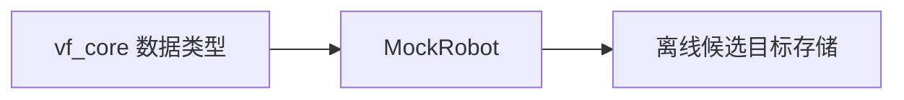

# 离线骨架架构

当前实现只包含 `vf_core` 类型和内存中的 `MockRobot`。真实机器人与传感器适配器、估计补偿、导纳控制器、安全监督、任务配置和日志回放都尚未实现。



`MockRobot::accept_candidate()` 只把输出保存在内存中，不连接网络、不加载 DRFL、不发送任何硬件命令。将来只有经过验证的运行时监督器可以把候选目标交给唯一的机器人命令适配器。

```text
include/vf_control/core/types.hpp
include/vf_control/mock/mock_robot.hpp
src/mock_robot.cpp
```

本阶段没有创建完整目标目录树，以免先搭空架子。后续 Gate 通过后再逐项增加硬件、估计、控制、运行时和任务模块。
