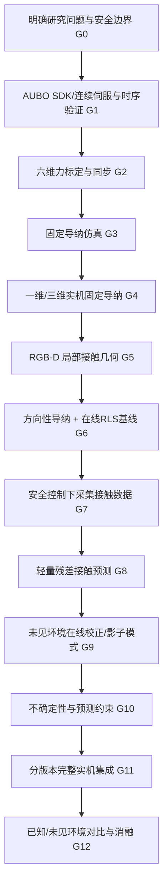
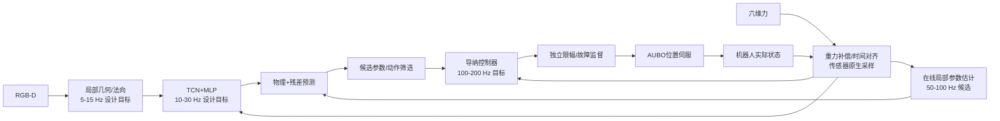

# 轻量级视觉—力觉接触响应学习与自适应导纳控制
## 从研究现状、科学问题和创新设计，到零基础开发、分阶段验收与完整实机实验的执行方案

> **文档属性**：研究方案与执行手册（研究假设版，不是已完成实验报告）  
> **版本**：V1.0 · 2026-10-21  
> **目标平台**：AUBO i16 六轴机械臂；RealSense D435i RGB-D 相机；待确认具体型号的六维力/力矩传感器；二指夹爪；RTX 3060 或 GTX 1080 Ti。  
> **推荐研究定位**：物理先验增强的轻量级接触响应学习 + 未见环境在线快速校正 + 不确定性感知的安全自适应导纳控制。  
> **核心原则**：先做稳定基线，再做学习；先离线预测，再实机影子运行；先做约束控制，再允许学习模块影响运动；每个功能均通过独立验收后再集成。  
> **重要声明**：本文提出的创新点、性能优势、开发周期与模型参数量均为研究设计或拟验证假设，**不是已经取得的实验结论**。任何实机控制必须服从所在实验室的机械臂、工装和人员安全规程。

---

## 阅读导航

| 部分 | 内容 | 推荐阅读时机 |
|---|---|---|
| **执行摘要** | 一句话问题、研究假设、完整流程图、完成定义 | 首先阅读 |
| **第一篇：研究现状与创新** | 相关工作、现有痛点、科学问题、研究贡献与创新边界 | 开题与文献对比 |
| **第二篇：硬件与数学模型** | AUBO/相机/六维力能力、坐标系、导纳、物理残差、RLS、不确定性与安全 | 正式设计前 |
| **第三篇：G0–G12 具体执行** | 每个阶段的输入、开发任务、测试、验收、交付与失败回退 | 实施过程中逐关使用 |
| **第四篇：模型和实验协议** | 数据集、训练、直接基线、未见环境泛化、消融、指标和图表 | G7–G12 |
| **第五篇：工程管理与决策** | 代码目录、环境、风险矩阵、Go/No-Go、第一周任务 | 全程 |
| **第六篇与附录** | 参考文献、验收模板、实验配置和完成判定表 | 查阅与留档 |

> **使用方法**：第 1 次阅读先看“执行摘要—第一篇—第二篇”；实际开发按第三篇逐关推进，同时填写附录 A 的验收记录。不要一次性开发所有模块。

---

# 执行摘要：一页了解整个课题

## 一句话研究问题

面对**训练中未见过的接触材料、局部几何和力学响应**，能否利用轻量级视觉—力觉模型预测短时接触力变化，结合实时力—位移反馈校正环境模型，并利用预测不确定性调整导纳参数，在不依赖大型策略网络和底层关节力矩控制的条件下，改善真实工业机械臂的接触力跟踪、过冲和适应速度？

## 核心研究假设

- **H1（物理残差建模）**：在一定范围的非线性、未见接触工况中，“局部物理接触模型 + 轻量残差网络”比单独的线性在线辨识或单独的小网络具有更好的短时力响应预测能力。
- **H2（在线快速适应）**：对训练中未见过的材料，无需重新训练网络，利用合法的历史接触数据在线更新等效物理参数，可以减少预测误差和控制性能退化。
- **H3（学习—控制耦合）**：通过短时力响应预测选择或限制导纳参数和候选位移，可以在一定工况下降低接触峰值或力跟踪误差，同时保持必要的任务运动精度。
- **H4（可信度与回退）**：对模型预测误差进行校准、在线监测并限制不可信预测对控制的影响，可降低模型失准带来的额外风险；这一机制**不是**物理安全的唯一屏障。
- **H5（轻量化部署）**：小规模 TCN/MLP 能够在 3060/1080 Ti 条件下完成训练和在线推理；导纳、状态机及保护逻辑独立运行于 CPU，不被 GPU 推理阻塞。

## 拟主打优势（需实验确认）

**第一优先级：未见接触环境下快速适应。** 辅助优势：接触力过冲控制、资源开销低、工程部署简单、失败状态可解释和可回退。不要在论文前期承诺“所有任务上最优”或“严格保证全局安全”。

## 总体路线



## 开发完成的定义

系统能在**已批准的低速单点/局部接触工况**中完成：RGB-D 获取局部几何 → 安全接近 → 六维力确认接触 → 网络预测局部力响应 → 在线辨识修正 → 约束下的方向性自适应导纳 → 曲面/平面恒力跟踪 → 异常安全退出。并能提供每个关键功能的独立测试、基线、消融结果和复现实验日志。

---

# 第一篇：研究背景、现状、痛点及科学问题

## 1. 背景与任务定位

视觉机器人抓取通常可以在自由空间中依据图像、深度、三维表面几何和标定关系产生运动目标。但当工具与物体实际接触时，视觉的深度误差、外参误差、工具装夹偏差、表面材料差异与摩擦会使“几何上正确的轨迹”未必具有合适的接触力。固定位置执行容易产生冲击或卡滞；固定导纳可以改善柔顺性，却难以对不同材料和接触阶段保持一致的效果。

本课题面向**具有外部位置/速度伺服接口的工业六轴机械臂**，不以直接输出关节力矩为前提。末端腕部六维力传感器观测工具与环境的合外力/力矩；RGB-D 相机估计局部表面位置、法向和几何质量；小型网络只处理与接触动力学相关的低维时序问题，不负责完整任务规划。控制层以物理导纳和独立安全监督为核心。

### 1.1 为什么优先做曲面恒力接触而不是复杂抓取？

在未知物体抓取中，任务成功会同时受目标检测、抓取姿态、摩擦、夹爪行程、夹持力与手指接触点影响，很难单独证明导纳算法的效果。平面/倾斜面/曲面恒力跟踪更便于控制变量、建立接触法向真值和重复采样，也可自然延伸至抛光、擦拭、表面检测和装配导向。完成核心机制验证后，再将二指夹爪用于工具夹持或柔顺插入。

**限制**：腕部六维力传感器测得的是合外力/力矩，不能直接量测二指夹爪内部可能相互抵消的法向夹持力。若后续目标是指尖抓取力闭环，须确认夹爪电流/力反馈或增加指尖触觉传感器。

## 2. 相关研究现状：哪些已经做过？

以下按**文献所提出的实际贡献**梳理，而非将文献内容视为本项目已有性能。引用地址和出版信息见文末参考文献。该表不是系统综述的终稿；准备投稿时还应扩大检索范围和核对相关工作时间线。

| 研究路线 | 代表研究 | 已有主要思路 | 本课题不能直接宣称为新颖之处 | 可迁移的原则 |
|---|---|---|---|---|
| 学习型阻抗 | Diffusion-Based Impedance Learning, T-RO 2026 [R1] | 力反馈条件化扩散模型重建虚拟零力平衡轨迹，通过能量关系调整方向性阻抗；在 KUKA iiwa 力矩控制平台验证 | “神经网络调整方向性阻抗”“能量相关的阻抗更新” | 学习与物理控制明确分工；评估平衡/接触一致性 |
| 视觉—力觉双策略 | Force Policy, RSS 2026 [R2] | 全局视觉与局部力觉策略解耦，估计交互坐标系，在局部控制中使用混合力—位置控制 | “用视觉力觉融合估计接触坐标系” | 不同频率、不同职责的异步系统；接触结构显式表示 |
| 接触预测与反应式位置控制 | FoAR, RA-L 2025 [R3] | 未来接触预测引导视觉/力觉融合，位置式反应控制 | “接触状态预测器+力觉输入” | 接触前/后应区别使用力觉；不必依赖力矩接口 |
| 示教学习柔顺 | ACP, ICRA 2025 [R4] | 示教生成近似柔顺标签，学习运动、虚拟目标与方向性刚度，采用位置型导纳 | “学习空间时间变化的柔顺参数” | 方向性柔顺与参考运动精度分工；对比固定刚度 |
| 稳定变阻抗 | Learning Stable State-Dependent VIC, T-Mech 2025 [R5] | 结构化神经能量函数编码状态相关变阻抗行为并分析稳定性 | “学习控制参数并关注稳定性” | 参数更新必须与稳定性分析关联 |
| 迭代学习型导纳 | Active Admittance Control with Iterative Learning, IEEE T-IE 2024 [R6] | 将导纳作为底层控制、迭代学习用于接触任务的参数优化 | “用数据/迭代更新导纳参数” | 作为低学习成本强基线；注意跨回合与单回合在线更新的差别 |
| 稳定性保障型变导纳 | Stability-Guaranteed Variable Admittance, IEEE T-SMC 2024/2025 [R7] | pH/能量罐与优化约束下的多场景变导纳 | “变导纳+能量罐” | 若主张稳定性，必须严格说明模型、假设与证明对象 |

### 2.1 文献对我们真正的启发

1. **学习不必端到端输出动作**。可以只学习人类或解析模型难以表示的接触响应，再由控制器决定是否采用。
2. **局部接触方向非常重要，但“视觉法向=接触法向”和“总力方向=接触法向”都不普遍成立**；摩擦、多点接触和惯性会破坏简单估计。
3. **方向性、时变导纳已有先例**，所以独立贡献应集中在可校正的局部接触预测及其与在线控制决策的耦合上。
4. **稳定性不等于限幅**。速度、参数上下限和超力停止是基础工程要求；证明被动性或稳定性需要额外模型与条件。
5. **实机与算法评价应分离**。有些论文使用 KUKA 力矩控制，有些使用特定实时混合力—位置接口；我们的可复现直接基线须在同一 AUBO 平台实现。

### 2.2 需要补充的文献检索方向

开题后建立可更新的文献矩阵，优先检索并比对：

- `contact dynamics learning + residual model + force prediction`；
- `online environment stiffness identification + recursive least squares + admittance`；
- `uncertainty aware admittance control + passivity + force limitation`；
- `vision force fusion + unseen material generalization`；
- `lightweight temporal force sensing + domain shift`；
- `delay-aware discrete-time admittance + position-controlled industrial robots`。

**新颖性判断标准**：对每个拟创新点，记录最相近论文的输入、输出、更新机制、执行接口、实验场景、代码可得性及不可比原因。不要因为网络更小或模块组合不同，就直接认定达到顶刊创新水平。

## 3. 当前痛点：从现象到可检验问题

### P1：视觉几何精度与接触力学需求错配

局部法向、位置和轨迹由 RGB-D 获得，但实际接触还取决于表面变形、摩擦、工具姿态和安装误差。**待解决**：如何把视觉几何作为接触预测的先验，同时利用真实力反馈修正其局限，而不是将视觉输出作为固定真值？

### P2：固定导纳难以兼顾不同接触刚度

相同的机器人微小位移，在硬质和软质工装上产生的力变化可能差别很大；单一虚拟刚度/阻尼可能在某些条件下力过冲大、在另一些条件下建立接触慢。**待解决**：如何在接触条件变化时实时选择合适的柔顺响应？

### P3：纯物理模型不足以描述所有接触非线性

简单的线性弹簧—阻尼模型无法完整描述软材料压缩、局部几何变化、迟滞、接触面积变化、摩擦等复杂行为。**待解决**：能否通过轻量残差模型补充而非替代物理模型？哪些工况确实需要神经网络？

### P4：训练模型遭遇未知材料时存在分布偏移

训练中出现的材料、工装和接触模式无法覆盖全部实机环境；纯离线网络可能置信度过高且预测失准。**待解决**：在不重新训练网络的前提下，如何利用新环境的少量合法接触历史快速校正？

### P5：预测效果未必能转化为控制收益

模型预测误差下降并不直接等于力跟踪提高。未来执行位移与指令位移不同，离散控制和通信延迟可能破坏基于预测的动作决策。**待解决**：如何将候选力变化预测转化为受限的导纳参数/动作选择，并在实机中实测收益？

### P6：参数变化和学习误差可能影响闭环稳定

导纳刚度的时变会改变虚拟储能；视觉/网络模块又是异步的。**待解决**：如何限定学习模块权限、限制候选控制动作，并设置不依赖网络的安全保护；如果提出理论保证，明确它适用的模型范围。

## 4. 研究问题（RQs）与验收依据

| 研究问题 | 要回答的核心问题 | 对应实验 | 失败时的研究处置 |
|---|---|---|---|
| RQ1 | 网络是否在非线性/未见材料条件下超过 RLS 的接触响应预测？ | G8 离线跨材料测试，Physics+Residual vs RLS vs Pure-TCN | 检查标签、动作条件与数据覆盖；不强行保留网络 |
| RQ2 | 在线校正是否用少量交互改善未见材料预测？ | G9 时间顺序在线回放，预测误差 vs 有效更新次数 | 复核可辨识性、残差结构与延迟；调整辨识假设 |
| RQ3 | 接触预测能否真正改善导纳力跟踪/过冲？ | G11–G12 控制实机对比 | 缩短预测时域或重新设计受约束动作选择 |
| RQ4 | 不确定性是否能识别失准并抑制不合适更新？ | 校准、OOD、完整/无可信度机制消融 | 使用误差监测、回退；避免“虚假安全保证” |
| RQ5 | 能否在限定硬件算力及控制接口下稳定部署？ | 实时周期 P50/P95/P99、丢周期、CPU/GPU 占用、持续运行 | 减少网络频率或回退纯物理方法 |

## 5. 拟创新点与“非创新项”严格区分

### C1（主要算法创新候选）：物理先验增强的轻量非线性接触响应预测

在短时间窗内，将物理接触模型与轻量 TCN/MLP 残差相结合，并显式把**候选运动、局部几何及运动历史**纳入预测。研究其对未见材料、曲率变化、接触非线性及较少数据的影响。

**应证明**：相对纯 RLS、纯 TCN、传统固定模型的预测误差改善，并且模型开销低、消融有效。**不应声称**：任何混合物理网络都是首创。

### C2（主打性能优势候选）：无需重新训练的在线局部物理校正

保留离线训练的轻量残差网络，用 RLS 或其他受约束辨识方法在线更新局部接触参数；测试模型遇到未见材料后，力预测和后续导纳性能随有效接触样本数量如何变化。

**应证明**：相同合法交互预算下，比纯离线模型/纯 RLS 更快达到合适误差；明确“zero-shot”和“adapted”不同协议。**不应声称**：所有未知环境都能在线辨识。

### C3（控制耦合贡献候选）：预测不确定性约束下的方向性自适应导纳

网络预测短时接触力变化及其不确定性；控制器生成一组小范围参数/动作候选，经过物理约束和模型预测筛选，再执行可允许的连续运动修正。学习层不直接发送未审查的伺服指令。

**应证明**：相对“只用网络预测但不控制”“有自适应无可信度”“常规变导纳”有独立控制收益。**不应声称**：仅靠概率上界可保证真实力不超限。

### 明确属于基础模块、不能单独包装为创新

AUBO C++ 通信、RGB-D 平面拟合、六维力重力补偿、一维固定导纳、状态机、普通 RLS、TCN 模型训练、参数上下限、基础急停。这些是科研系统的必要组件，但单独不足以构成论文主创新。

## 6. 论文定位及研究边界

**中文暂题**：《面向未知接触环境的轻量级视觉—力觉接触响应学习与安全自适应导纳控制》  
**英文暂题**：*Lightweight Vision–Force Contact Response Learning for Adaptive Admittance Control in Unseen Environments*

**首篇论文主实验**：平面、倾斜面、可控曲面上的低速持续接触与法向恒力跟踪。  
**扩展实验**：柔顺擦拭/表面处理；在条件具备时增加单点导向插入或接触式抓取。  
**暂不覆盖**：高动态碰撞、人的近距离交互安全认证、全身复杂接触、灵巧手内力控制、完全未知形状的自主抓取成功率承诺、无条件全局稳定性证明。

---

# 第二篇：硬件、接口能力与数学问题建模

## 7. 现有硬件与可行性审查

| 设备/资源 | 已知信息 | 主要任务 | 尚待确认 |
|---|---|---|---|
| AUBO i16 | 六轴工业协作机器人；以实验室实际型号为准 | 外部位置/关节伺服、位姿状态 | 控制柜、固件、SDK、连续伺服能力、真实延迟、底层安全机制 |
| 腕部六维力传感器 | 有六维力/力矩能力；型号未确定 | 测外界作用力/力矩 | 量程、分辨率、采样率、安装方向、时间戳、原生驱动 |
| RealSense D435i | RGB-D 相机 | 局部点云、法向和区域质量 | 安装位置、遮挡、标定方式、有效视场、工作距离 |
| 二指夹爪 | 型号和反馈能力待确认 | 抓持工具与扩展实验 | 力/电流反馈、TCP 与工具质量 |
| RTX 3060/GTX 1080 Ti | 两种可用 GPU 候选 | 网络训练、可选推理 | 实际显存、驱动、CUDA/PyTorch 兼容性 |
| CPU/操作系统 | 未确认配置 | 控制周期、通信、RLS、导纳 | CPU 型号、可用核心、Linux 内核/调度、网卡、实测抖动 |

### 7.1 从前期 AUBO i16 学位论文可获得的有限证据

已有师兄的博士论文在 AUBO i16 上实现过外部 C++ 视觉伺服和约 200 Hz 位点指令的系统设计，说明该型号具备外部高频运动控制的工程实例。**本项目不基于师兄代码、感知算法或系统实现开展改造**；上述信息仅作为设备性能和接口能力的参考。是否能在即将使用的实际控制柜上稳定达到相同周期，必须在 G1 独立验证。

### 7.2 核心可行性判断

- **计算资源**：3×3 矩阵导纳、RLS 与有限候选评估主要运行于 CPU；5 万至 30 万参数的轻量时序网络可作为第一版的设计规模，在现有 GPU 上训练具有现实可行性。
- **执行接口**：优先使用外部位置型导纳。即测力 → 算位移修正 → 连续发送位姿或经逆运动学转换后的关节位点。**不把直接关节力矩接口作为前置条件**。
- **关键风险**：不是 GPU，而是机器人连续伺服周期、状态反馈时延、力数据延迟、工具补偿、控制器内部插补逻辑及接触安全性。

## 8. 系统级分层架构与频率预算



**上述数字全是设计目标**，须由 G1/G2 时序测试和 G11 集成测试重新确定。视觉和网络不能阻塞高频控制。力传感器实际采样率应支持所选控制频率，并评估抗混叠、滤波和时间戳质量。

### 8.1 分层权限设计

| 层级 | 允许做什么 | 禁止做什么 |
|---|---|---|
| 感知层 | 输出几何、力/速度历史、数据有效性、时间戳 | 直接向机械臂发送位置修正 |
| 学习层 | 输出预测力变化、预测不确定性、辅助接触状态 | 直接控制关节、解除安全限幅 |
| 在线辨识层 | 根据有效历史数据估计局部等效参数 | 在冲击、无接触、饱和、不可辨识状态下无条件更新 |
| 控制层 | 依据目标力和候选预测计算受约束导纳更新 | 无约束大幅修改参数，或忽略实际反馈 |
| 安全层 | 限幅、超时检测、选择经验证的回退/停止 | 依赖网络预测作为唯一保护 |
| AUBO 底层 | 按厂商机制执行位置伺服、安全状态处理 | 同时运行两个互相冲突的外部/厂家力控外环 |

## 9. 坐标系、观测变量和模型边界

建议统一定义以下坐标系：

- `{B}`：机器人基坐标系；
- `{E}`：末端法兰坐标系；
- `{S}`：力传感器测量坐标系；
- `{T}`：工具 TCP 坐标系；
- `{C}`：局部接触坐标系，法向为 $\mathbf n$，切向为 $\mathbf t_1,\mathbf t_2$；
- `{V}`：相机坐标系。

所有位置、速度、力/力矩、法向必须在确定的统一参考系和同一作用点下计算。六维力坐标变换不仅包含旋转，还包含参考点变化产生的力臂项；不允许对整个六维 wrench 只做简单的三维旋转。

### 9.1 接触法向与实际力

视觉表面法向 $\mathbf n_v$ 只是几何先验。存在摩擦时，合外力 $\mathbf F$ 一般不与表面法向平行；多点接触时，腕部合 wrench 也无法唯一恢复接触点和法向。因此第一阶段实验限定单一局部接触，并在稳定接触/低速条件下估计法向分量：

$$
F_n=\mathbf n^{\mathsf T}\mathbf F_{\mathrm{ext}}.
$$

接触方向正负号须在 G2 用实验统一定义，避免“力大反而继续压入”的符号错误。

### 9.2 外部位置型导纳模型

以三维平移外环为主：

$$
\mathbf M_d\ddot{\mathbf e}+\mathbf D_d(t)\dot{\mathbf e}+\mathbf K_d(t)\mathbf e
=\mathbf F_{\mathrm{ext}}-\mathbf F_d,
$$

$$
\mathbf x_{\mathrm{cmd}}=\mathbf x_{\mathrm{ref}}+\mathbf e.
$$

这里 $\mathbf e$ 是相对于任务参考位置的柔顺位移，不是控制器内部任意位置误差。不同接触状态使用不同的 $\mathbf F_d$ 与参考更新逻辑；**不能在自由空间保持非零目标接触力持续积分**。采用固定正定 $\mathbf M_d$，先在仿真与低速单轴实机中验证离散积分和符号。

对于方向选择性导纳：

$$
\mathbf P_n=\mathbf n\mathbf n^{\mathsf T},\qquad
\mathbf P_t=\mathbf I-\mathbf P_n,
$$

$$
\mathbf K_d(t)=k_n(t)\mathbf P_n+k_t(t)\mathbf P_t,
$$

$$
\mathbf D_d(t)=d_n(t)\mathbf P_n+d_t(t)\mathbf P_t.
$$

方向变化时投影矩阵同样变化，不能仅对标量刚度进行变化率限制；还要限制法向旋转速率或完整矩阵变化率。

### 9.3 物理接触模型：从可解释的局部线性到非线性残差

在低速、局部、稳定、近似单点接触条件下，先使用局部增量关系：

$$
\Delta F_{n,t+H}\approx
\hat k_{e,t}\Delta\delta_{t:t+H}+
\hat b_{e,t}\Delta\dot\delta_{t:t+H}.
$$

$\hat k_e$、$\hat b_e$ 是机器人—工具—环境系统的**局部等效接触参数**，不一定等于材料本体常数。法向压入量 $\delta$ 应尽量依据**实际末端位姿与工装几何**计算，而不是直接拿指令位移当作压入量。

用残差网络描述物理近似以外的变化：

$$
\widehat{\Delta F}_{n,t+H}
=\underbrace{\hat k_{e,t}\Delta\delta+
\hat b_{e,t}\Delta\dot\delta}_{\text{物理项}}
+\underbrace{r_\phi(\mathbf g_t,\mathbf h_t,\mathbf a_{t:t+H})}_{\text{学习残差}},
$$

其中 $\mathbf g_t$ 为视觉几何特征，$\mathbf h_t$ 为历史 wrench、实际位姿/速度、运动命令等，$\mathbf a_{t:t+H}$ 为拟执行的短时动作候选。

**关键防泄漏约束**：离线训练时可以使用实际发生的历史位移构建标签，但用于下一步在线候选动作预测时不得访问未来实际位移。应通过 G1 测得的近似伺服响应模型，从未来**候选指令**推测可执行的位移，并以真实动作响应误差评价模型。

### 9.4 在线参数校正

在稳定接触和数据可辨识时，用 RLS 等算法更新 $\hat k_e$，可选更新 $\hat b_e$：

$$
y_t=\Delta F_{n,t},\quad
\boldsymbol\varphi_t=[\Delta\delta_t,\Delta\dot\delta_t]^{\mathsf T},\quad
\hat{\boldsymbol\theta}_{e,t}=[\hat k_{e,t},\hat b_{e,t}]^{\mathsf T}.
$$

RLS 可以使用遗忘因子、投影到物理可接受范围、低激励冻结、异常残差拒绝和接触模式门控。**无接触/冲击/传感器饱和/运动激励不足时禁止无条件更新**。

### 9.5 不确定性与预测约束

轻量模型输出可设计为未来法向力变化的均值和标准差 $\hat\mu_{\Delta F},\hat\sigma_{\Delta F}$；使用独立验证集做可信度校准，未见材料另设 OOD 评价。

候选动作的筛选示意：

$$
F_{n,t}+\hat\mu_{\Delta F,t+H}+\beta\hat\sigma_{\Delta F,t+H}
\le F_{\mathrm{soft-limit}}.
$$

此式只是**模型条件下的保守候选动作过滤**，并非对真实力的严格上界。硬件力限、控制位置/速度限制和异常停止逻辑必须独立保留。若预测失效或超时，改用已验证的保守控制/停止逻辑，而不是继续未经审查的动作。

### 9.6 时变参数能量分析的正确边界

对固定虚拟惯量的理想导纳模型，虚拟储能

$$
V=\tfrac12\dot{\mathbf e}^{\mathsf T}\mathbf M_d\dot{\mathbf e}
+\tfrac12\mathbf e^{\mathsf T}\mathbf K_d(t)\mathbf e
$$

满足形式上的能量变化：

$$
\dot V=\dot{\mathbf e}^{\mathsf T}(\mathbf F_{\rm ext}-\mathbf F_d)
-\dot{\mathbf e}^{\mathsf T}\mathbf D_d\dot{\mathbf e}
+\tfrac12\mathbf e^{\mathsf T}\dot{\mathbf K}_d\mathbf e.
$$

最后一项可能为正，方向变化同样影响 $\dot{\mathbf K}_d$。即使矩阵始终正定、参数有上下界，也不能自动推断整体机器人—环境系统稳定。若以后以被动性/稳定性为论文理论贡献，须针对**离散时间、实际位置伺服、延迟与接触假设**给出相应论证；不要从上述理想式直接推出实机全局保证。

## 10. 开发中的工程约束与安全总则

1. 实机初期仅开展低速、小范围、经过审批的单接触实验。末端准备软质接触垫与可重复固定工装；所有危险范围清空。
2. 具体接触力、力矩、速度、最大退让/压入位移、急停阈值由实验室依据**实际工具、传感器量程和硬件评估**确定，文档不凭空指定数值。
3. 先有经验证的硬件停止及厂家控制器保护，再上自编外环。任何网络、优化器或安全“预测”不能解除这些机制。
4. 传感器数据过期、时间戳失效、通信故障、异常抖动、位置跟踪误差、法向失效、神经网络超时都应有确定的回退状态。
5. 不同时启用两个会修正同一自由度的外部导纳与厂家力控外环，以免相互冲突。
6. 实验参数配置要版本化；从基线到完整方法的安全规则保持一致，不能为获得更好结果取消某一基线的基础保护。

---

# 第三篇：G0–G12 从零实现、功能开发、验收与交付

## 11. 通用阶段准入机制

每个 Gate 均需保留：**输入条件 → 开发任务 → 单元测试 → 联合测试 → 日志与图表 → 验收记录 → 失败回退**。未通过验收，不进入下一关；每关冻结一套配置及源码版本。时间是规划估算，不作为项目成功的保证。

### 总进度建议

| Gate | 周期 | 首要目标 | 阶段冻结成果 |
|---|---|---|---|
| G0 | 第1周前段 | 边界、风险、工具和工装 | 安全清单与接口清单 |
| G1 | 第1–2周 | AUBO 状态/连续位置伺服 | servo 基线、时序报告 |
| G2 | 第3–4周 | 六维力/姿态/同步 | 力标定与有效数据流 |
| G3 | 第5周 | 固定导纳仿真 | 仿真控制器、单测 |
| G4 | 第6–8周 | 真实一维→三维固定导纳 | 可靠接触闭环 |
| G5 | 第9–10周 | D435i 局部几何 | 位置/法向/质量数据 |
| G6 | 第11–12周 | 方向性导纳与 RLS | 强非学习基线 |
| G7 | 第13–15周 | 安全数据采集和标注 | V1 接触数据集 |
| G8 | 第16–18周 | 训练物理残差网络 | 离线预测对比 |
| G9 | 第19–20周 | 未见环境在线校正 | 影子模式验证 |
| G10 | 第21–22周 | 不确定性与候选控制约束 | 约束模块/校准报告 |
| G11 | 第23–24周 | 分版本完整联调 | 算法冻结版本 |
| G12 | 第25–30周 | 强基线、泛化、消融 | 论文级结果 |

## G0：研究边界、设备状态与安全准备

**目的**：确定初期实验对象和每项设备的真实能力，避免边做边换任务。  
**输入**：设备清单、控制柜资料、工具与工装、实验室安全规程。  
**任务**：

1. 核对 AUBO i16 本体/控制柜/示教器/固件；整理控制器版本和许可功能。
2. 记录六维力传感器型号、额定量程、超载能力、安装坐标与采集协议；计算工具总负载/质心。
3. 确定固定平面 + 软质接触垫作为初期标准工装；准备可重复定位的倾斜面与材料模块。
4. 制定无接触伺服、接触建立、恒力保持、异常退出的安全作业程序；排除人员进入运动空间。
5. 按设备实际风险评估设置并记录必要的力、力矩、运动、时间戳和跟踪误差限值。
6. 建立实验模板：目的、批准人、装置、软件/参数版本、预期风险、停止条件、日志路径。

**验证**：急停、厂家保护、通信异常后的行为经安全负责人确认；无工具松脱；工装可靠。  
**验收**：安全边界与工装固定方案经过确认；不再使用模糊的“先小力试试”作为唯一防护。  
**交付**：`docs/hardware_inventory.md`、`docs/safety_plan.md`、`configs/limits.yaml`（待核准数值）。  
**失败回退**：设备信息不全或保护不明确，禁止开展自动接触。

## G1：AUBO 控制接口与连续伺服

**目的**：独立验证机器人是否支持本研究要求的位置型外部导纳。  
**输入**：G0 通过，SDK/控制器匹配。  
**开发顺序**：

1. 安装兼容 SDK、构建官方最小 C++ 状态读取示例；记录操作系统和编译版本。
2. 编写 `aubo_state_reader`：关节角/速度、TCP 位姿、错误码、安全状态、反馈时间戳。
3. 编写 `aubo_servo_test`：进入连续伺服、发送低速经核准的无接触轨迹、停止并正确退出伺服模式。
4. 分别验证笛卡尔连续伺服是否可用，以及必要时的 IK + 关节连续伺服回退通道。
5. 编写 `aubo_timing_test`：比较目标周期与真实发送周期；记录回包时延、状态刷新、期望/实际位置误差。
6. 逐步对 50/100/200 Hz 等候选频率开展批准范围内测试，选择**实测可靠**而非数字最高的方案。
7. 测试线程抢占、网络波动、程序退出、状态丢失和命令超时后的安全行为。

**关键日志**：`t_send,t_feedback,q_cmd,q_act,TCP_cmd,TCP_act,error,state,cycle_overrun`。  
**验收**：低速连续运动平滑；实际闭环轨迹误差和 P95/P99 周期可被度量；中断/超时有可靠回退；连续运行无不可接受的抖动。  
**交付**：`robot/aubo_interface.*`、`robot/servo_controller.*`、`reports/G1_timing.md`、原始日志。  
**失败回退**：选择较低周期；复核 SDK 插补/伺服模式、CPU/网络和操作系统；若仅有分段运动接口则应重新评估实时导纳路线。

## G2：六维力读数、标定、同步及异常检测

**目的**：建立可用外力测量而不误把重力/惯性/零偏当作接触力。  
**开发顺序**：

1. 独立采集力/力矩原始六通道，带单调时钟时间戳和有效性标志。
2. 多姿态采集空载/安装工具后的静态数据，进行零偏与工具重力/质心估计。
3. 标定传感器 `{S}` 到工具/法兰 `{T}/{E}` 变换；正确实施 wrench 力和力矩的坐标/参考点变换。
4. 完成简单低通滤波，并分别记录原始值、补偿值、滤波值及滤波延迟。
5. 基于统一时钟或可估计的时钟偏移，对齐真实机器人状态与六维力数据。
6. 加入数据过期、异常峰值、饱和、通信中断与零漂检查。安全监督保留独立原始数据通道。
7. 用合规的已知载荷或校准设备验证力和力矩的响应与单位。

**验收**：多个无接触姿态下的补偿后残余力/力矩足够小，较计划目标接触力有明显裕量；接触信号方向正确；无超时数据进入高频控制。  
**交付**：`sensors/ft_reader.*`、`ft_calibration.*`、标定记录、`reports/G2_force_validation.md`。  
**失败回退**：重新标定质量/质心/工具方向；增加参考测量，绝不以软件阈值掩盖错误传感器方向。

## G3：一维导纳与简化接触仿真

**目的**：不接真实工装先验证控制数学正确性。  
**开发顺序**：

1. 构建一维弹簧—阻尼单边接触仿真，支持接触建立与分离。
2. 构建简化的机器人位置伺服动态（时滞、一阶响应、限速），参数可依据 G1 实测修改。
3. 实现固定 $M_d,D_d,K_d$ 导纳离散积分，测试符号、数值稳定性和最大位移约束。
4. 加入 FREE/APPROACH/CONTACT/STABLE/RETREAT/FAULT 状态机，明确每个状态的目标力与允许动作。
5. 扫描环境刚度、阻尼、力测噪声、控制采样率、延迟，生成稳定与失败区域图。
6. 加入断传感器、延迟跳变、法向翻转、接触分离等单元测试。

**验收**：力过大时沿正确方向退让；自由空间非零期望力不会驱动无界位置修正；离散模型无数值爆炸；故障场景有确定响应。  
**交付**：`simulation/contact_environment.py`、`admittance_sim.py`、单元测试及参数初值范围。  
**失败回退**：检查符号、积分饱和、离散方法及底层伺服近似；不直接拿失败参数上实机。

## G4：实机一维→三维固定导纳闭环

**目的**：建立不依赖视觉与模型的第一项可靠实机成果。  
**开发顺序**：

1. 无接触低速测试固定导纳代码与外部伺服的数值连续性。
2. 固定工具朝向，在经核准的软垫工装上进行单轴接近、初始接触检测、低速恒力保持、退让。
3. 保存命令/实际位置、原始/补偿力、目标力、导纳状态、控制周期。
4. 在标准平面上低速进行切向移动，观察法向力与切向误差。
5. 扩展为三维平移导纳，先保持法向与切向参数固定，限制速度/加速度/位移修正。
6. 比较位置控制（有相同基本保护）与固定导纳的接触力和轨迹性能。

**验收**：至少可以稳定重复完成“接近—接触—恒力—移动—退出”的全过程，接触力和实际 TCP 有对应的完整曲线；故障退出成功。  
**交付**：`control/fixed_admittance.*`、G4 实机日志与视频、固定导纳基线参数。  
**失败回退**：检查实际执行延迟、力补偿、参考轨迹与导纳修正双重积分、状态切换的目标力突变。

> **里程碑 M1：未完成 G4，不允许进入学习控制。** 这套系统是任何后续论文方法都必须保留的可复现基本基线。

## G5：D435i 局部视觉几何

**目的**：建立可复现、可标定的局部接触几何先验。  
**开发顺序**：

1. 测相机内参，建立相机至基坐标系的外参；确认是固定外部相机还是随末端运动的安装方式。
2. 获取 RGB/Depth 与有效深度掩膜，完成接触区域 ROI 检测与采样。
3. 局部点云去噪、平面拟合/PCA 法向估计；根据工装定义统一法向符号。
4. 提取法向 $\mathbf n_v$、几何拟合残差、有效深度点数、曲率或局部粗糙度估计。
5. 实现视觉数据带时间戳异步缓存，丢帧或低质量时标记无效而非盲目沿用旧法向。
6. 在已知倾角平面、简单曲面和局部遮挡条件下验证角度误差。

**验收**：相机与机器人坐标变换正确；已知倾角下法向误差可量化；视觉置信度与残差/遮挡存在合理对应；控制线程不会等待图像。  
**交付**：`perception/geometry.*`、相机标定及角度误差报告。  
**失败回退**：固定相机姿态、缩小 ROI、限制首版工装形状；不直接把低质法向用于控制。

## G6：方向选择性导纳 + RLS 自适应基线

**目的**：建立“没有深度学习”的强基线，验证真实需要学习的部分。  
**开发顺序**：

1. 使用 G5 法向构造 $\mathbf P_n,\mathbf P_t$，实现法/切向不同的固定刚度与阻尼。
2. 对法向切换进行符号对齐、时间平滑和变化速率限制。
3. 在线计算稳定接触下的实际法向位移和法向力增量，先实现标量 RLS $\hat k_e$。
4. 确认数据足够辨识时再加入 $\hat b_e$，防止强相关输入导致病态估计。
5. 基于 RLS、接触状态和力误差，实现有界、平滑的经典自适应导纳更新律。
6. 在几种有不同刚度的材料上对比 Fixed-Adm、Directional-Adm、RLS-Adapt。

**验收**：RLS 在稳定可辨识场景有合理估计，失去接触/传感器饱和时会冻结；变导纳无不合理抖动；比较得到真实差异而非仅显示功能正常。  
**交付**：`control/directional_adm.*`、`adaptation/contact_rls.*`、三组经典基线。  
**失败回退**：先测试实际位移/力增量的对齐，排除工具柔性和估计坐标变化对 RLS 的干扰。

> **里程碑 M2：G6 是学习模型存在必要性的判据。** 后续的 TCN 必须相对 RLS 和已有变导纳方法体现独立增益。

## G7：安全数据采集、标注与数据集协议

**目的**：获得能够监督**力响应预测**而不是仅进行接触分类的数据集。  
**数据来源**：G4–G6 已通过的控制器执行、完整记录状态、工装材料与实验条件；未训练好的网络不得直接控制机械臂。  
**开发顺序**：

1. 写统一实验配置与时间同步日志，定义 `trial_id/material_id/geometry_id/session_id`。
2. 初期选择经批准的平面、倾斜面、曲面、软硬材料，以及不同低速接触和切向运动工况。
3. 先采集 30–50 条完整先导接触试验，检查力动态、实际位移、标签和同步误差。
4. 用相机/工装真值、力历史和人工复核标注自由运动、接触建立、稳态接触、异常接触；避免仅凭单个力阈值自动产生全部标签。
5. 形成候选运动—短时未来力变化样本，明确“未来真实数据仅用于监督标签，不进入在线预测输入”。
6. 按工装和完整试验划分数据：训练、验证、已见环境测试、**未见材料测试**、**未见几何测试**、接触扰动测试。
7. 检查类别平衡、噪声、传感器漂移、工装磨损、试验顺序与重复度。
8. 根据先导结果逐步扩展第一版数据集，200–400 条短时试验可作为起步采集预算，最终数量依实际多样性和统计需求确定。

**日志字段最低要求**：`timestamp_ns,trial_id,session_id,material_id,geometry_id,q,qdot,TCP_actual,TCP_cmd,raw_wrench,compensated_wrench,RGB/depth_ref,normal,geometry_quality,contact_mode,safety_state,control_period,validity_flags`。

**验收**：数据可回放；时间线单调且可对应；完整试验及材料级数据隔离严格；未见材料不进入训练和调参；具备可复查的标签说明。  
**交付**：`dataset_v1/`、`dataset_card.md`、预处理脚本、训练/测试划分 manifest。  
**失败回退**：先修复同步/工装变化问题再扩大采集规模；不要用大网络补偿坏数据。

## G8：轻量物理残差预测网络

**目的**：验证网络相对纯物理模型的必要性。  
**网络设计起点**：

- 力/运动历史分支：最近约 0.5 s 的 6D wrench、TCP 位移/速度、合法的历史指令，3–4 层 1D TCN；
- 视觉分支：法向、曲率、局部几何拟合质量，2–3 层 MLP；
- 候选动作分支：候选未来位移/速度变化、预测时域、控制阶段；
- 输出：未来法向接触力变化均值，及可选方差/接触状态概率；
- 第一版设计预算：约 5 万至 30 万参数，预测时域先比较 50 ms 和 100 ms；样本率与网络长度按 G7 数据确定。

**开发顺序**：

1. 首先实现 Zero/Constant、Linear-RLS、Pure-MLP、Pure-TCN 四组预测基线。
2. 训练 Physics+Residual 网络，冻结数据规范，严格按训练集统计量归一化。
3. 主损失采用接触力变化回归（Huber/MAE 或概率负对数似然）；接触状态分类作为可选辅助损失。
4. 训练集采用批次/材料均衡采样，验证集选择超参数，未见测试集直到冻结模型再评估。
5. 统计已见/未见工装上的 MAE、RMSE、分位数误差、峰值力变化预测误差。
6. 消融视觉分支、力历史、运动分支、物理项、残差项、窗口长度、预测时域。
7. 导出推理模型，记录 CPU/GPU 单次推理延迟、模型大小和内存。

**关键防泄漏**：不能将未来真实 TCP 位移、未来 wrench、同一次试验相邻样本拆分入训练/测试；动作候选必须可从当前时刻发出的控制候选及已知模型构造。  
**验收**：Physics+Residual 对至少一类事先定义的非线性未见工况呈现可信、可复现的独立预测优势；即使未达到预期也完整记录负面结果。  
**交付**：`learning/contact_tcn.py`、训练脚本、冻结权重、预测对比表、离线分析。  
**失败回退**：先核查输入可观测性、样本对齐、模型输出含义；若纯 RLS 相当或更优，则缩减学习模块或改变问题，避免“为了神经网络而神经网络”。

## G9：在线校正与实机影子模式

**目的**：证明遇到未见材料时无需重新训练就能持续修正预测。  
**开发顺序**：

1. 冻结 G8 网络权重，不在高频控制线程里在线反向传播。
2. 使用带门控的 RLS 更新 $\hat k_e$，必要时更新 $\hat b_e$；结合历史实际接触反馈修正物理预测。
3. 对未见材料进行因果顺序离线回放，仅使用时刻 $t$ 以前的有效数据更新当前模型。
4. 比较 Frozen-Physics、RLS-only、Frozen-TCN、Physics+Residual frozen、Physics+Residual+RLS。
5. 用有效接触样本数、累计位移激励、在线运行时间等表示“适应预算”。
6. 在真实 AUBO 上启用**影子模式**：G6 可靠控制器负责运动，预测模块只读数据、只记录，不改变伺服。
7. 测推理超时、数据失效、模型失准、材料切换后的在线适应曲线。

**验收**：在线校正不依赖测试未来信息；在未见环境下误差变化可分析、在线更新有明确激励门控；影子模式长期运行不影响控制周期。  
**交付**：`adaptation/residual_fusion.*`、在线误差曲线、影子模式测试报告。  
**失败回退**：降低更新频率，先固定法向，排查预测时域与实际位移误差；不让未经验证的模块进入闭环。

> **里程碑 M3：如果 G9 未体现可重复的未见材料在线改进，暂不进入学习驱动导纳。** 先重新评估论文的主打优势。

## G10：不确定性校准与保守候选筛选

**目的**：研究模型失准时如何抑制不适当参数更新和前向压入动作。  
**开发顺序**：

1. 在 G8 模型上增加均值/方差头或 3 个小型模型集成；先选择计算开销更低的一种。
2. 以独立验证数据评估预测区间覆盖率、负对数似然、误差 vs 预测不确定性、风险—覆盖率；进行必要的温度/方差校准。
3. 对未见材料、未见曲率和噪声工况评估过度自信问题，增设实时历史残差报警。
4. 建立导纳参数候选集合或解析更新律，包含参数范围、增量限制和法向变化率限制。
5. 用预测 $\hat F_{t+H}$ 和不确定性过滤候选压入动作；不可靠则冻结学习驱动增量或进入保守状态。
6. 所有候选还要经过**真实测力/力矩、实际 TCP、速度、加速度、状态和通信有效性**等独立安全规则。
7. 先在 G3 仿真、后在 G9 影子数据中评估，最后才将经过确认的有限功能投入低速实机。

**验收**：模型失准时能被识别或回退；正常时不产生不连续大幅增益切换；不确定性对控制收益/代价的影响可量化。  
**交付**：`control/predictive_filter.*`、`control/safety_supervisor.*`、不确定性校准报告。  
**失败回退**：关闭模型驱动的参数优化，保留固定导纳/纯 RLS；必要时退回单轴且使用更低速度。

## G11：分版本完整实机联调

**目的**：将经验证的模块整合成可持续运行的研究性原型。  
**集成顺序，不可一次全开**：

- **V1**：AUBO + F/T + 视觉几何 + 固定导纳；
- **V2**：V1 + 网络影子预测（只记录）；
- **V3**：V2 + RLS 在线校正 + 可信度评估（仍主要由成熟导纳控制）；
- **V4**：V3 + 受约束的导纳参数/动作候选更新；
- **V5**：在稳定基础上完成平面、倾斜面、曲面和未见材料任务。

每个版本单独记录源代码提交号、配置文件、网络权重、工装编号、标定版本和日志路径。

**高频控制主循环逻辑（伪代码，仅用于软件设计）**：

```text
while system_running:
    robot = read_latest_valid_robot_state()
    wrench = read_latest_valid_compensated_wrench()
    if hardware_or_state_fault(robot, wrench):
        invoke_validated_stop_or_retract(); continue

    mode = contact_state_machine(robot, wrench)
    if mode == FREE:
        candidate = safe_free_space_reference()
    elif mode in [CONTACT, STABLE]:
        geometry = latest_valid_geometry_or_fallback()
        prediction = latest_prediction_if_fresh()
        if identifiable_and_stable_contact():
            update_local_RLS_from_past_observations()
        parameters = bounded_admittance_parameters(mode, prediction)
        candidate = admittance_step(parameters, robot, wrench)
        candidate = predictive_restriction_if_valid(candidate, prediction)
    else:
        candidate = validated_retract_or_stop()

    command = independent_motion_and_safety_filter(candidate)
    send_servo_command(command)
    log_all_inputs_outputs_and_timestamps()
```

**注意**：此伪代码不含厂商安全协议、机器人具体停机 API、运动学求解、实时资源管理，不可未经审批直接用于机械臂执行。

**验收**：独立控制频率稳定；视觉/网络超时不阻塞高频循环；断线、力异常、坐标错误有确定回退；不同版本实机任务能重复完成；系统不会因为参数切换出现明显速度跳变。  
**交付**：冻结 `full_method_v1`、系统视频、连续完整日志、功能验收单。  
**失败回退**：关闭新增模块逐层定位原因；保持最低级有效的受保护固定导纳可用。

## G12：实验、基线、消融、泛化与论文结果

**目的**：从“系统运行正常”提升到“有证据支持研究假设”。  
**固定要求**：同一 AUBO/相机/F/T、相同安全限制、相同工装和参考轨迹、明确训练/测试隔离；不允许只拿不同论文的异构实验成功率进行横向排行。  
**开发任务**：

1. 选择至少一项公式与控制接口适配的已发表自适应/变导纳算法，复现为真实外部基线；保留实现差异说明。
2. 冻结数据、任务、指标、方法配置；完成实验前的重复性检查。
3. 先执行已知环境基础对比，再未见材料和几何泛化，最后进行扰动及异常回退验证。
4. 所有方法保持基础安全保护。若增强预测约束为本文贡献，消融只能取消增强项，不能取消最小硬件保护。
5. 采用随机化/交叉实验顺序，减少工装磨损、温升、力零漂及实验先后顺序的混淆。
6. 记录全部失败、不达标或无法完成的试验，并区分接触失败、预测失准、伺服超时与安全停机。
7. 报告均值、分布、置信区间/适当统计检验及计算成本；不将“没有发生事故”表述为严格安全证明。
8. 确认核心贡献在未见环境、非线性响应和控制收益上都有证据，然后撰写论文。

**验收**：核心对比表、泛化曲线、在线适应曲线、消融与失败分析齐全；关键实验能按日志和配置复现。  
**交付**：论文可用图表、冻结基线、代码版本、完整的实验说明和结果摘要。

---

# 第四篇：模型训练、数据与完整实验协议

## 12. 数据集的监督目标与输入输出规范

### 12.1 推荐先学习“短时增量”而不是绝对接触力

对相邻时刻 $t,t+H$ 计算真实接触力变化 $\Delta F_{n,t+H}=F_{n,t+H}-F_{n,t}$；对候选运动采用目前可用的指令/伺服动态估计构造训练输入。若模型直接回归绝对力，容易受工具零偏和初始预载变化影响，后续可作为消融。

### 12.2 窗口构建和时间同步

- 原始力和位置保存最高可用率的独立流；训练时按时间戳统一对齐。
- 每个训练样本的历史窗口只允许取 $[t-W,t]$，标签允许来自 $t+H$。
- 候选动作需要在预测时刻已知或可以生成；不能使用 $t+H$ 的实际 TCP 作为在线输入。
- 缺失/过期数据要单独标注，而不是未经检查的插值。
- 标准化统计量只能由训练数据计算，切勿使用完整数据集统计量。

### 12.3 接触状态与真值来源

- `FREE/APPROACH/INITIAL_CONTACT/STABLE/SLIDING/ANOMALY` 应有文字定义和标注争议处理方式；
- 表面法向真值来自可标定的工装或可靠几何参考；不能以腕部总力方向作为无条件法向真值；
- 材料类别可作为分组元数据，建议不作为网络必须输入，以免只记忆已知材料 ID；
- 任务目标接触力、限幅与工具几何由配置元数据提供。

## 13. 训练流程与消融结构

### 13.1 预测基线

| 方法 | 学习网络 | 在线物理模型 | 目的 |
|---|---|---|---|
| Persistence | 无 | 无 | 力变化零预测/简单趋势基线 |
| Linear-RLS | 无 | 有 | 经典可解释在线估计 |
| Pure-MLP | 小型 MLP | 无 | 检查时序模型必要性 |
| Pure-TCN | 小型 TCN | 无 | 纯学习能力 |
| Physics+Residual | TCN/MLP | 有但离线冻结 | 物理先验+学习残差 |
| Physics+Residual+Online | TCN/MLP | 有且合法在线更新 | 主算法的在线预测部分 |

### 13.2 训练/验证拆分

建议明确四种**不同泛化含义**：已见物体新试验、未见材料、未见几何、未见材料与几何组合。某项工作只在已见试验上优秀，不能宣传材料泛化。按完整试验/材料/采集日期进行分组划分，不允许窗口泄漏。

### 13.3 不确定性评价

除 MAE、RMSE 外，报告覆盖率、预测区间平均宽度、误差分位数、过度自信失败案例及分布外检测性能。对未见材料的置信度退化应单独展示。可信度用于控制时需有过期检测与回退。

## 14. 实机对比方法设计

| 编号 | 算法 | 直接实机复现目标 |
|---|---|---|
| B0 | 位置控制（带相同最低安全约束） | 对比基本接触行为，不作危险高力测试 |
| B1 | Fixed Admittance | 经典固定导纳 |
| B2 | Conventional Adaptive Admittance | 仅基于力误差调整导纳参数 |
| B3 | Directional Fixed Admittance | 视觉局部法向、法切分离、固定方向性参数 |
| B4 | RLS-Based Adaptive Admittance | 无神经网络，在线等效接触估计 + 导纳 |
| B5 | Learning-Only / Frozen Model Admittance | 仅离线轻量模型，不在线校正 |
| B6 | 代表性已发表变导纳/稳定型导纳方法 | 选择可复现且与位置接口匹配的强相关方法 |
| Ours | Physics+Residual+Online+Uncertainty-Constrained Admittance | 完整方法 |

**严禁**：把 ACP/FoAR/Force Policy 某个简化模块重新命名为其“完整复现”。如研究资源不足以复现大型学习策略，只能在 Related Work 中进行定性机制比较，不可虚构同平台定量结果。

## 15. 正式实验矩阵

### E1：固定平面——基础恒力跟踪

目标：证明完整方法至少不明显损害基本控制能力。  
变量：目标法向接触力、初始接触位置偏差、低速切向轨迹。  
评价：法向力 RMSE、稳态误差、过冲、稳定时间、切向位移误差、异常退出率。

### E2：倾斜面和曲面——方向适应

目标：评价局部几何先验与方向性导纳的价值。  
变量：工装倾角、曲率、不同视角、已知扰动法向角。  
评价：法向角误差、切向轨迹误差、力稳定性；说明摩擦和多接触工况限制。

### E3：未见材料——主打的在线快速适应

训练集**完全不出现**测试材料。先运行 zero-shot，后允许在线校正；每个方法获得公平合法交互预算。  
横轴：有效在线更新次数、合法交互时间或累计安全压入激励。  
纵轴：短时力变化 MAE、力 RMSE、接触峰值及稳定时间。  
重点报告首次接触瞬态和适应后稳态，避免只报告有利的末尾阶段。

### E4：非线性接触——检验残差网络是否必要

选择具有可重复非线性力—位移关系的工装，比较 Linear-RLS、Pure-TCN、Physics+Residual 以及 Full。在可控范围内改变压入量与速度。  
目标：证明网络确实补足了线性物理模型无法刻画的部分，而不只是记忆材料 ID。

### E5：扰动与模型误差——不确定性控制的价值

引入预先评估的视觉法向误差、少量遮挡、接触条件切换、力传感数据延迟模拟或有限的环境扰动。  
比较 Full 和关闭增强可信度模块的控制器，但保持各自相同最低安全措施。  
观察模型是否过度自信、参数是否错误大幅调整、是否触发合理回退。

### E6：持续运行与实时性

记录高频控制周期的 P50/P95/P99、最长周期、丢周期率、预测模块更新速率与超时、CPU/GPU 占用、机器人跟踪误差。  
报告实际使用频率与真实延迟，不以标称 200 Hz 代表系统闭环带宽。

### E7：应用扩展（可选）

在 E1–E6 结果稳定后，使用二指夹爪夹持工具执行柔顺擦拭/局部导向插入或视觉抓取中的接触缓冲。清楚区分腕部外力控制与夹爪内力控制，避免夸大“精确夹持力控制”。

## 16. 完整消融表

| 消融名称 | 移除/替换部分 | 对应要证明的独立价值 |
|---|---|---|
| w/o Physics | 仅网络预测 | 物理先验是否降低误差/数据需求 |
| w/o Residual | 仅 RLS/物理模型 | 非线性学习是否必要 |
| w/o Online | 物理参数冻结 | 未见环境在线适应是否必要 |
| w/o Vision | 不提供局部视觉几何 | 视觉先验是否增加泛化能力 |
| w/o Force History | 不使用历史 wrench 时序 | 时序力觉是否必要 |
| w/o Uncertainty | 不使用增强可信度调节 | 模型可信度是否降低失准风险 |
| Fixed Direction | 法向不随估计更新 | 方向变化机制是否必要 |
| Full | 全部模块 | 综合收益 |

消融只能关闭被研究的**增强模块**，不能取消硬件/软件基本保护。所有方法训练样本数量、模型规模、推理预算以及交互预算应尽量公平或明确披露差异。

## 17. 评价指标与统计规则

| 类别 | 指标 | 说明 |
|---|---|---|
| 预测性能 | $\mathrm{MAE}_{\Delta F}$、$\mathrm{RMSE}_{\Delta F}$ | 短时法向力变化预测 |
| 预测可靠性 | 覆盖率、预测区间宽度、NLL、过度自信比例 | 检查预测方差是否可信 |
| 在线适应 | 达到某个固定误差水平所需合法样本数/时间、适应前后误差 | 同交互预算公平比较 |
| 力控制 | $\mathrm{RMSE}_F$、峰值、过冲量、稳定时间 | 力跟踪及冲击 |
| 运动精度 | 切向 TCP 轨迹误差、实际/指令 TCP 误差 | 防止为了柔顺牺牲精度 |
| 任务能力 | 完成率、任务时间、安全停止次数 | 完成率与安全拒绝分开统计 |
| 鲁棒性 | 扰动恢复、未见材料/几何相对性能下降 | 不能用单一总体平均替代 |
| 实时性 | P50/P95/P99 周期、超时、丢周期、模型更新率、资源利用率 | 真实设备采集 |

对于同一工装的重复试验，可以将每组约 20–30 次作为第一版实验预算，之后按波动和统计功效调整。结果至少报告均值与置信区间，并根据成对试验设计采用适当统计方法。试验编号和停止原因必须完整保留，不得只统计成功结束的轨迹。

## 18. 预期论文图表

| 编号 | 内容 | 回答什么问题 |
|---|---|---|
| Fig. 1 | 整体感知—预测—在线校正—控制架构 | 系统机制是什么 |
| Fig. 2 | 局部物理先验 + TCN 残差结构 | 网络具体学什么 |
| Fig. 3 | RLS 校正与预测约束控制机制 | 如何适应并约束更新 |
| Fig. 4 | 固定/经典变导纳/完整方法力曲线 | 是否带来控制收益 |
| Fig. 5 | 未见材料在线预测误差随有效样本变化 | 主打快速适应优势 |
| Fig. 6 | 非线性、曲率、视觉扰动的代表性案例 | 泛化和鲁棒性 |
| Fig. 7 | 预测误差 vs 不确定性、覆盖率/风险曲线 | 可信度是否可靠 |
| Table I | 设备、接口与模型配置 | 可复现性 |
| Table II | 已见/未见接触预测性能 | 物理残差是否必要 |
| Table III | 机器人力控与运动性能 | 控制优势 |
| Table IV | 主要消融实验 | 哪个模块起作用 |
| Table V | 资源成本与持续运行时序 | 轻量化部署 |

---

# 第五篇：工程组织、风险、路线决策与第一周任务

## 19. 推荐工程仓库结构

```text
vision_force_admittance/
├── README.md
├── docs/
│   ├── hardware_inventory.md
│   ├── safety_plan.md
│   ├── research_matrix.md
│   ├── interface_spec.md
│   └── gate_reports/
├── configs/
│   ├── robot.yaml
│   ├── sensor.yaml
│   ├── transforms.yaml
│   ├── controller.yaml
│   ├── limits.yaml
│   └── experiment.yaml
├── robot/
│   ├── aubo_interface.cpp
│   ├── state_reader.cpp
│   └── servo_controller.cpp
├── sensors/
│   ├── ft_reader.cpp
│   ├── ft_calibration.cpp
│   └── realsense_reader.cpp
├── perception/
│   ├── geometry.cpp
│   ├── contact_state.cpp
│   └── synchronization.cpp
├── simulation/
│   ├── contact_environment.py
│   └── admittance_sim.py
├── control/
│   ├── fixed_admittance.cpp
│   ├── directional_admittance.cpp
│   ├── adaptive_admittance.cpp
│   ├── predictive_filter.cpp
│   └── safety_supervisor.cpp
├── adaptation/
│   ├── contact_rls.cpp
│   └── residual_fusion.cpp
├── learning/
│   ├── dataset.py
│   ├── contact_tcn.py
│   ├── train.py
│   ├── evaluate.py
│   ├── calibrate_uncertainty.py
│   └── export_model.py
├── data/
│   ├── raw/
│   ├── processed/
│   └── manifests/
├── experiments/
│   ├── baseline/
│   ├── unseen_material/
│   ├── nonlinear_contact/
│   ├── uncertainty/
│   └── ablation/
├── tests/
│   ├── test_transforms.cpp
│   ├── test_admittance.cpp
│   ├── test_rls.cpp
│   └── test_fault_handling.cpp
├── logs/
└── results/
```

**工程规范**：每次实机实验记录代码 commit、`model_hash`、参数配置、工具安装、标定版本、工装 ID、运行时间和异常状态。禁用将控制阈值硬编码在多个文件中。原始数据只读保存；派生数据、分析脚本和图表保持可重建关系。

## 20. 开发环境与技术选型

| 功能 | 首选技术 | 原因与注意事项 |
|---|---|---|
| 实机控制/SDK | 匹配控制柜版本的 AUBO C++ SDK | 外部伺服、状态读取、可测延迟；不直接依赖过往学位论文代码 |
| 高频数学 | C++17 + Eigen | 低分配、低开销、便于单元测试 |
| 相机 | librealsense + Open3D/PCL | 低维几何提取，不必训练大型视觉网络 |
| 物理仿真 | Python/NumPy，必要时 PyBullet/MuJoCo | 初期一维模型足够，后期扩展 |
| 网络训练 | PyTorch | 小型 TCN/MLP、训练/验证管理 |
| 网络推理 | ONNX Runtime 或 TorchScript/C++ | 以当前环境真实时延/依赖为准 |
| 在线辨识 | Eigen 中 RLS | CPU 实时可运行，便于门控 |
| 数据存储 | Parquet/NPZ/HDF5 + 图像路径索引 | 高速时序、复现和批量读取 |
| 统计绘图 | Python + Matplotlib/Pandas | 独立离线处理 |
| 版本管理 | Git + 固定环境文件 | 精确定位实验算法版本 |

**关于 GPU**：RTX 3060 与 1080 Ti 均可考虑，但需核实实际显存和驱动兼容；对轻量模型来说，优先把学习网络做小、数据做对、时序做准。若两种 GPU 的驱动生态不同，以可稳定部署的设备为优先选择。控制环即使 GPU 忙碌或不可用也应能执行保守路径。

## 21. 失败风险矩阵和预案

| 风险 | 典型症状 | 优先排查 | 应对 |
|---|---|---|---|
| AUBO 外部伺服不稳 | 指令抖动、跟踪滞后、模式退出 | SDK、周期、CPU/网卡、插补 | 降频、优化通信、改变控制带宽，必要时暂停该路线 |
| 六维力补偿错误 | 无接触时姿态变化导致假力 | 质量/质心、变换、零偏 | 重新标定，禁止进入接触闭环 |
| 方向/符号错误 | 力过大反而压入 | 法向定义、力正负、控制目标 | 停止实机，返回 G3 仿真 |
| 视觉法向跳变 | 柔顺方向瞬间旋转 | 点云、法向符号、ROI | 平滑、置信度门控或冻结 |
| RLS 不可辨识 | 刚度乱跳或不收敛 | 实际位移激励、噪声、采样延迟 | 门控、限幅、先估计单参数 |
| 网络看似准确但实机无效 | 离线 MAE 优秀，闭环不改善 | 未来信息泄漏、动作条件、伺服动态 | 真实候选输入、影子模式验证 |
| 未见材料失效 | 测试集误差过大 | 训练覆盖、残差结构、OOD | 增加跨材料数据或限制适用范围 |
| 预测不确定性过低 | OOD 过度自信 | 校准、分组覆盖率 | 误差监测、保守回退，勿宣称严格安全 |
| 变导纳振荡 | 力与位置周期振荡 | 时变刚度、延迟、低阻尼、方向变化 | 降低更新幅度、提高阻尼、返回稳定基线 |
| 任务效果无显著差异 | 不同方法指标接近 | 基线公平、任务强度、统计功效 | 重新定义有价值的挑战，不伪造优势 |
| 数据泄漏 | 训练/测试精度反常接近 | 相邻窗口、同试验、标准化 | 重新按物体/材料/试验划分 |
| 工装条件漂移 | 相同参数结果变差 | 温度、磨损、工具更换、零偏 | 重新校准、交叉实验、记录工装状态 |

## 22. 三个决策点（Go/No-Go）

### D1：G4 后——能否独立完成可靠固定导纳？

- **Go**：低速接触循环可靠，力和位置可对齐，停机逻辑经过验证。
- **No-Go**：先解决底层伺服、力补偿或实际延迟；不进行神经网络训练来“掩盖”控制问题。

### D2：G8/G9 后——神经网络是否比纯 RLS 有必要？

- **Go**：在事先确定的未见非线性工况下，网络残差带来可重复且统计上有意义的预测改进，且在线校正能用合理预算适应。
- **No-Go**：重新检查输入和数据；仍无改善则采用物理辨识方案或调整研究问题。
- **可选预期目标**：在关键未见非线性工况下预测 MAE 下降约 10%–20% 可作为希望达到的效果，而非未经验证的保证或唯一通过线。

### D3：G11/G12 后——预测优势是否转化为控制优势？

- **Go**：在匹配条件下，过冲、力 RMSE、恢复时间或任务可靠性至少有明确、可重复的收益，同时没有不可接受的轨迹精度/时延代价。
- **No-Go**：缩小预测时域、审查候选参数机制或实测延迟；若始终无收益，不能把“更准确预测”直接包装为“更好控制”。

## 23. 第一周可执行清单

| 日程 | 需要做的事 | 当日提交成果 |
|---|---|---|
| Day 1 | 记录 AUBO i16 控制柜、固件、SDK、OS、机器人状态和网络拓扑 | `hardware_inventory.md` |
| Day 2 | 下载/整理匹配的 SDK；阅读状态接口、连续伺服接口、错误/停止接口 | `interface_spec.md` |
| Day 3 | 编译最小状态读取程序，正确记录六轴位置和 TCP 位姿及时间戳 | `state_log.csv` |
| Day 4 | 在 G0 安全条件下，进行无接触、低速、小幅连续伺服测试 | 轨迹对比与原始日志 |
| Day 5 | 测目标与实际周期、发送时延、状态刷新、TCP 跟踪误差 | `G1_timing_report.md` |
| Day 6 | 确认 F/T 传感器型号、驱动、量程和坐标方向，采集静态原始数据 | 设备资料与 `raw_wrench_log` |
| Day 7 | 汇总硬件可行性、工作频率候选和下周 G2 标定计划 | `Gate_G1_review.md` |

**第一周禁止事项**：尚无有效力补偿和急停验证时就让神经网络控制机器人；未经批准开始硬接触；直接复制他人学位论文的代码作为研究贡献。

## 24. 论文写作与研究审计规则

- 在每一 Gate 完成后写一页摘要：功能、输入输出、关键参数、验收结果、失败案例和下一步。
- 论文方法必须区分“物理模型、训练网络、在线辨识、受约束控制、安全保护”，避免一张大框架图掩盖真正创新。
- 正式实验前冻结算法和评价指标，防止看到结果后反复调节阈值来追求“最好看”的数字。
- 每个性能优势至少要有一个外部或独立强基线、一组直接消融、一项未见环境验证。
- 若没有完整的稳定性证明，准确使用“参数有界”“安全回退”“在测试工况内稳定运行”等表述，不使用“全局稳定性/严格安全保证”。
- 论文所有数值只采用真实日志和可复现统计；对外部工作不做跨平台成功率的直接优劣宣称。

---

# 第六篇：参考文献与技术资料

> 以下参考文献用于明确技术边界、复现线索及创新性对照。**文献中的实现和实验结果不是本项目成果**。投稿前应继续更新文献矩阵并核对原文细节。

1. **[R1]** *Diffusion-Based Impedance Learning for Contact-Rich Manipulation Tasks*. IEEE Transactions on Robotics, 2026. DOI: https://doi.org/10.1109/TRO.2026.3717255 ；主要参考：力条件化扩散、虚拟平衡轨迹、能量相关的方向性阻抗调整。
2. **[R2]** *Force Policy: Learning Hybrid Force-Position Control Policy under Interaction Frame for Contact-Rich Manipulation*. Robotics: Science and Systems, 2026. 论文: https://www.roboticsproceedings.org/rss22/p128.html ；项目: https://force-policy.github.io/ ；主要参考：交互坐标系、视觉全局与力觉局部策略分工。
3. **[R3]** *FoAR: Force-Aware Reactive Policy for Contact-Rich Robotic Manipulation*. IEEE Robotics and Automation Letters, 2025. DOI: https://doi.org/10.1109/LRA.2025.3560871 ；代码: https://github.com/Alan-Heoooh/FoAR ；主要参考：未来接触预测、视觉/力觉阶段融合、位置接口反应式执行。
4. **[R4]** *Adaptive Compliance Policy: Learning Approximate Compliance for Diffusion Guided Control*. IEEE ICRA, 2025. DOI: https://doi.org/10.1109/ICRA55743.2025.11128452 ；项目: https://adaptive-compliance.github.io/ ；主要参考：近似柔顺标签、方向性刚度、位置型导纳执行。
5. **[R5]** *Learning Stable State-Dependent Variable Impedance Control for Compliant Manipulation*. IEEE/ASME Transactions on Mechatronics, 2025. DOI: https://doi.org/10.1109/TMECH.2024.3466950 ；作者公开稿: https://livrepository.liverpool.ac.uk/id/eprint/3188763 ；主要参考：SNEUM 与状态相关变阻抗稳定性结构。
6. **[R6]** *Active Admittance Control with Iterative Learning for General-Purpose Contact-Rich Manipulation*. IEEE Transactions on Industrial Electronics, 2024. 可检索入口: https://arxiv.org/abs/2403.16560 ；主要参考：迭代学习与导纳参数优化，作为传统/低学习成本路线的比较对象。具体复现以正式论文控制律为准。
7. **[R7]** *A Stability-Guaranteed Variable Admittance Control Architecture for Complex Physical Interaction Tasks With Multiple Scenarios*. IEEE Transactions on Systems, Man, and Cybernetics: Systems, 2024 在线发表. DOI: https://doi.org/10.1109/TSMC.2024.3514154 ；主要参考：端口哈密顿与能量罐、带稳定性依据的变导纳。
8. **[R8]** AUBO 官方 SDK/连续伺服开发文档（版本可能变化）：https://docs.aubo-robotics.cn/aubo_sdk_docs/en/ ；https://docs.aubo-robotics.cn/application_notes/53-servoj/index.html 。**以实际控制柜、固件及官方匹配版本手册为准**。
9. **[R9]** Hogan, N. *Impedance Control: An Approach to Manipulation, Part I—Theory*. ASME Journal of Dynamic Systems, Measurement, and Control, 1985. DOI: https://doi.org/10.1115/1.3140702 。经典阻抗控制理论背景。

---

# 附录 A：阶段验收记录模板

```markdown
## Gate: Gx / 实施日期 / 负责人
### 硬件与软件版本
- Robot/controller/firmware:
- SDK / OS / CPU / GPU:
- Tool, sensor and calibration version:
- Git commit / config hash:

### 本次工作范围与输入
...

### 功能实现与单元测试
...

### 时序、力、位移、安全与其他评价
- Measured control period P50/P95/P99:
- Tracking error:
- Force residual / contact force statistics:
- Abnormal / timeout trials:

### 通过判据（实验前定义）与结果
...

### 失败案例和原因
...

### 决策
[ ] 通过并冻结  [ ] 仅部分通过  [ ] 回退整改

### 数据/代码/图表路径
...
```

# 附录 B：实验前配置和记录清单

```yaml
experiment:
  trial_id: "REPLACE_ME"
  task: "flat_surface_constant_force"
  material_id: "REPLACE_ME"
  geometry_id: "REPLACE_ME"
  robot_firmware: "REPLACE_ME"
  sdk_version: "REPLACE_ME"
  git_commit: "REPLACE_ME"
  calibration_version: "REPLACE_ME"
  model_hash: "none_or_hash"
  controller_mode: "fixed_admittance"
  control_period_s: null    # 必须填写实测验证值
  sensor_sample_rate_hz: null
  target_normal_force_n: null   # 依据安全审批及工装任务设定
  max_allowed_force_n: null    # 不得照抄其他项目阈值
  max_tcp_speed_m_s: null
  max_position_correction_m: null
  permitted_workspace: null
  contact_mode_definition: "approved_protocol"
  stop_protocol: "validated_hardware_and_software_protocol"
```

# 附录 C：项目完成判定表

| 完成条件 | 证据文件 | 完成状态 |
|---|---|---|
| 独立安全与接口验证通过 | G0/G1/G2 报告 | 待完成 |
| 一维与三维固定导纳可重复 | G3/G4 日志与视频 | 待完成 |
| 视觉几何与在线 RLS 基线通过 | G5/G6 报告 | 待完成 |
| 数据集无明显泄漏且标注可追溯 | G7 manifest 与 dataset card | 待完成 |
| Physics+Residual 离线对比完成 | G8 预测表、消融 | 待完成 |
| 未见环境在线校正因果回放通过 | G9 适应曲线 | 待完成 |
| 不确定性校准与回退功能通过 | G10 测试与校准 | 待完成 |
| 完整实机受限接触闭环通过 | G11 冻结版本与日志 | 待完成 |
| 泛化、外部基线、消融、时序实验齐全 | G12 图表及统计 | 待完成 |
| 研究假设被明确证实或证伪，并据此调整论文主张 | 最终技术报告 | 待完成 |

---

## 最后建议

严格按照 **G0 → G1 → G2 → G3 → G4 → G5 → G6 → G7 → G8 → G9 → G10 → G11 → G12** 顺序推进。第一阶段只确认基础控制是否可靠；到 G6 再判断学习模块是否真的必要；到 G9 再判断“未知环境快速适应”能否成立；到 G12 才判定完整方法的性能优势与论文创新是否得到实证支持。

**本项目最核心的科研价值不是“视觉 + 力觉 + TCN + 导纳”的模块组合，而是：在真实位置伺服机械臂上，以可解释的局部接触物理模型为基础，通过轻量残差学习与在线校正预测未见环境的力学响应，并把预测信息以受约束的方式转化为柔顺控制收益。**
